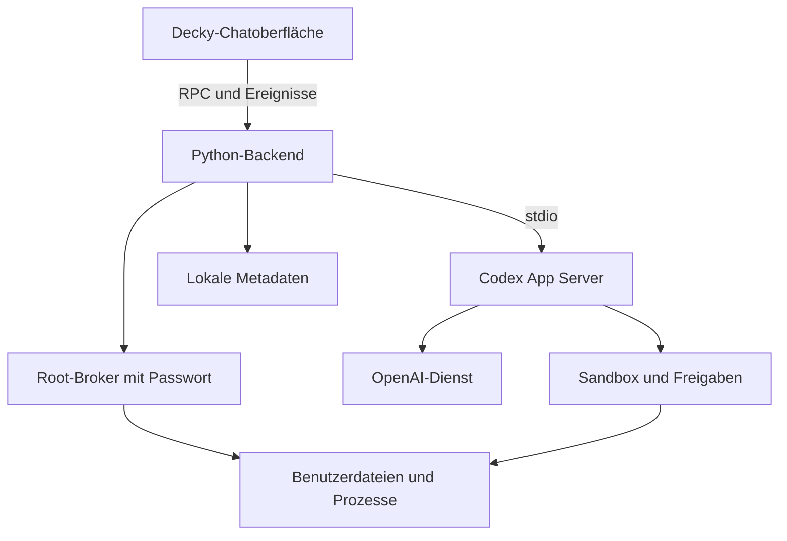

# Decky Codex – technischer Umsetzungsplan

Stand: 21. Oktober 2026. Status: Planung, keine Implementierung.

Repository: [Kevni92/decky-codex](https://github.com/Kevni92/decky-codex).

Dieses Dokument legt Architektur, Funktionsumfang, Sicherheitsmodell, Schnittstellen, Entwicklungsschritte und die spätere ZIP-Veröffentlichung fest. Es ist die Grundlage für nachfolgende Implementierungs-PRs. Mit diesem Dokument werden weder Plugin-Code noch ausführbare GitHub-Workflows angelegt. Das Repository war bei der Bestandsaufnahme leer; es existieren noch keine Projektkonventionen, Tests oder Workflows.

## 1. Ziel und Umfang

Decky Codex integriert einen handlungsfähigen KI-Assistenten in den Gaming-Modus des Steam Decks. Nutzer schreiben Aufgaben in natürlicher Sprache, verfolgen die Ausführung und bestätigen notwendige Zugriffe und Änderungen. Das Plugin verwendet eine lokal laufende Codex-Runtime; die Modellinferenz erfolgt über OpenAI und benötigt Internet. Es wird kein lokales Sprachmodell auf dem Deck betrieben.

### Geplanter Funktionsumfang

| Bereich | Erste nutzbare Version | Spätere Erweiterung |
| --- | --- | --- |
| Chat | Streaming mit Markdown/Tabellen, Aktivitätspanel, Frage-/Aktionskarten und Verlauf | Suche, Export, Anhänge |
| Bedienung | Decky-Einstieg, große Chatansicht, Controller, Touch, Bildschirmtastatur | Zusätzliche Eingabehilfen |
| Anmeldung | ChatGPT-Tarif über einen für diese Integration zulässigen offiziellen Anmeldeweg | Weitere ausdrücklich gewählte Provider |
| Diagnose | Lesender Zugriff und Speicheranalyse mit Steam-Spiel-Ausschluss, Ergebnistabelle und bestätigter Bereinigung | Umfangreichere Diagnoseabläufe |
| Änderungen | Einzelne freigegebene Befehle und Dateiänderungen als Benutzer | Begrenzte, geprüfte Installationsrezepte |
| Installation | Benutzerinstallationen und textbasierte Installer mit erklärten Rückfragen | EmuDeck und weitere grafische Installer nach Nachweis |
| Systemverwaltung | Benutzeraktionen und optional einzeln freigegebene Root-Aufträge mit Passwort | Weitere geprüfte Systemrezepte |
| Veröffentlichung | Installierbare ZIP je erfolgreichem Build und Release-Asset | Aufnahme in den Decky Plugin Store |

Nicht Bestandteil der ersten Version: allgemeine Root-Shell, automatische SteamOS-Basisupdates, Deaktivieren des schreibgeschützten Systembereichs, beliebige GUI-Fernsteuerung, Sprachassistent, Cloud-Chat-Synchronisierung oder automatisches Eingreifen in laufende Spiele. ChatGPT-Webverläufe werden nicht importiert. Die Oberfläche ist eine eigene Codex-Anwendung, keine eingebettete ChatGPT-Website.

## 2. Verifizierte Grundlagen und offene Nachweise

Folgende Grundlagen wurden anhand der offiziellen Quellen geprüft. Die Links stehen gesammelt in Abschnitt 18; die nachfolgenden Architekturentscheidungen sind Projektfestlegungen und keine Zusicherungen der Anbieter.

- Die Codex CLI ist für Linux verfügbar; das OpenAI-Repository nennt ein natives Linux-x86_64-musl-Artefakt. Damit besteht eine geeignete Grundlage für Steam Deck. Die tatsächliche SteamOS-Kompatibilität einschließlich Sandbox und benötigter Hilfsprogramme bleibt am Gerät zu testen. [Q1]
- Der App Server bietet strukturierte Kommunikation für Clients, einschließlich Threads, Streaming und Freigaben. Die Integration verwendet dessen versioniertes Schema statt Terminaltext auszuwerten. [Q2]
- Offizielle Anmeldewege und Tarifnutzung sind dokumentiert; Verfügbarkeit, Kontoberechtigung und Kontingente sind zu prüfen. Die aktuellen Hinweise empfehlen für eigene Anwendungen „Sign in with ChatGPT“. Bestehende lokale/Open-Source-App-Server-Anbindungen werden gesondert behandelt; eine neue Anwendung darf deren Zulässigkeit nicht einfach voraussetzen. [Q3, Q4]
- Deckys offizielles Template verwendet TypeScript, Rollup, `@decky/api`, `@decky/ui` und ein asynchrones Python-Backend. [Q6]
- EmuDeck dokumentiert einen interaktiven Installationsablauf. Eine vollständig unbeaufsichtigte Installation im Gaming-Modus ist hierdurch nicht belegt. [Q9]

### Verbindliche Nachweise vor der eigentlichen Produktentwicklung

| Nachweis | Durchführung in der späteren Umsetzung | Konsequenz bei Fehlschlag |
| --- | --- | --- |
| Native Runtime | Gepinnte Runtime auf SteamOS starten, Protokoll initialisieren | Kein Ersatz durch Abschalten der Sandbox; kompatibles Bundle untersuchen |
| Berechtigungen | UID/GID, Sandbox, Dateiverbote und Netzwerkgrenzen am Deck testen | Aktionsmodus bleibt gesperrt |
| Anmeldung | Zulässigen OAuth-Weg für eine neue lokale Open-Source-App dokumentieren; echten Turn durchführen | Keine Zusage zur Tarifnutzung, kein stiller Wechsel zur API-Abrechnung |
| Decky-Oberfläche | Route, Fokusführung, Tastatur, Ereignisse und Wiederverbinden prüfen | Kompaktere Ansicht als Zwischenlösung, Einschränkungen dokumentieren |
| Installations-ZIP | Paket in unterstützter Decky-Version installieren und aktualisieren | Keine Freigabe als installierbares Release |
| EmuDeck | Aktuellen offiziellen Installer, Interaktivität und Gaming-Modus testen | Geführte Übergabe statt Erfolgsmeldung ohne abgeschlossene Installation |

Die dabei ausgewählten Decky-, Codex- und Toolchain-Versionen werden anschließend im Repository festgehalten. Dieser Plan erfindet keine bereits getestete Versionskombination.

## 3. Architekturentscheidungen

| Entscheidung | Festlegung | Begründung |
| --- | --- | --- |
| Frontend | React/TypeScript mit Deckys Komponenten und Rollup | Integration in Steam-Fokusführung und Plugin-Lebenszyklus |
| Backend | Python mit `asyncio`, möglichst Standardbibliothek | Passt zum Decky-Backend und reduziert Laufzeitabhängigkeiten |
| Codex-Anbindung | Ein lokal beaufsichtigter `codex app-server` über `stdio` | Strukturierte bidirektionale Kommunikation ohne eigenen Netzwerklistener |
| CLI-Verteilung | Versioniertes natives Linux-x86_64-Bundle im Plugin-Paket | Kein Node/npm und keine globale CLI-Installation auf dem Deck erforderlich |
| Prozessrechte | Backend und Codex ohne `_root`-Flag; Start nur als Decky-Benutzer | Modellbefehle erhalten keine geerbten Root-Rechte |
| Parallelität | Ein App-Server-Prozess und zunächst ein aktiver Turn insgesamt | Verhindert konkurrierende Installationen und senkt Ressourcenbedarf |
| Verlauf | Codex-Threads als Quelle des Gesprächs; SQLite für Plugin-Metadaten | Keine zwei unabhängig fortgeschriebenen Chatverläufe |
| Freigaben | Native Codex-Freigaben plus technische Ausführungsgrenzen | Ein Systemprompt ist keine Sicherheitsgrenze |
| Kontozugang | Austauschbare Auth-Schicht; bevorzugt offizieller Weg für neue Drittanwendungen | Änderungen an OAuth und Tarifnutzung bleiben lokal begrenzt |
| Updates | Plugin und getestetes Runtime-Bundle gemeinsam aktualisieren | Kein unangekündigter Protokollwechsel durch CLI-Selbstupdates |

Die Freigabeanzeige im Frontend entscheidet über anstehende Anfragen; sie führt keine Befehle aus. Das Backend ordnet Antworten der konkreten Anfrage zu. Die Runtime und ihre Betriebssystemgrenzen erzwingen den erlaubten Zugriff. Der optionale Root-Broker ist eine eigene Vertrauensgrenze: Nur die ausdrücklich freigegebene Aktion wird nach lokaler Passwortauthentifizierung privilegiert ausgeführt. Die allgemeinen Backend-/Codex-Prozesse bleiben Benutzerprozesse.

## 4. Geplante Repository-Struktur

Alle hier genannten Dateien außer diesem Dokument sind zukünftige Arbeit.

| Pfad | Verantwortung |
| --- | --- |
| `docs/IMPLEMENTIERUNGSPLAN.md` | Dieses Architektur- und Ablaufdokument |
| `docs/COMPATIBILITY.md` | Getestete SteamOS-/Steam-/Decky-/Codex-Kombinationen |
| `docs/SECURITY.md` | Zugriffsmodell, Datenfluss, Einschränkungen und Meldung von Problemen |
| `docs/DEVELOPMENT.md` | Lokaler Build, Testverfahren, Paketierung, Releaseverfahren |
| `src/index.tsx` | Plugin registrieren, Routen und Listener an-/abmelden |
| `src/views/` | Einstieg, Chat, Verlauf, Einstellungen, Anmeldung |
| `src/components/` | Nachricht, Befehlsausgabe, Dateidiff, Freigabedialog |
| `src/state/` | Zustandsautomat und Verarbeitung normalisierter Ereignisse |
| `src/services/backend.ts` | Typisierte Decky-Aufrufe und Ereignisabonnement |
| `main.py` | Kleine Decky-Einstiegsklasse mit öffentlichen RPC-Methoden |
| `backend/codex/` | Prozessverwaltung, Protokolladapter, Versionsprüfung |
| `backend/services/` | Auth, Chats, Freigaben, Persistenz, interaktive Installer und Dateiinventare |
| `backend/privilege/` | Root-Broker, separater Auth-Kanal und kurzlebiger privilegierter Runner |
| `backend/tools/` | Begrenzte Modellwerkzeuge für Fragekarten, Installer, Inventare und Aktionsvorschläge |
| `agent/` | Mitgeliefertes Runtime-Regelwerk, Skillpaket, Quellen und Manifest |
| `AGENTS.md` | Künftige Regeln für Entwicklungsagenten, getrennt von der Runtime-Rolle |
| `backend/security/` | Profilverwaltung, Pfadprüfung, redigierte Diagnosedaten |
| `schemas/codex/` | Aus der ausgewählten Runtime erzeugte Protokollschemata |
| `schemas/plugin/` | Eigenes versioniertes Frontend-/Backend-Protokoll |
| `runtime/manifest.json` | Genaue Runtime-Version, Quellen, Hashes und Bundle-Dateien |
| `scripts/` | Reproduzierbare Build-, Paketierungs- und Paketprüfprogramme |
| `tests/frontend/`, `tests/backend/`, `tests/contracts/` | Automatisierte Tests |
| `.github/workflows/ci.yml` | Künftige Prüf- und Paketierungs-Pipeline |
| `.github/workflows/release.yml` | Künftige Release-Pipeline |
| `plugin.json`, `package.json`, `pnpm-lock.yaml`, `rollup.config.js` | Decky-Metadaten und Frontend-Build |
| `LICENSE`, `THIRD_PARTY_NOTICES.md` | Projektlizenz und Hinweise zu mitgelieferten Komponenten |

Produktname: **Decky Codex**. Paketkennung: **decky-codex**. Verbindliche Paketversion steht in `package.json`; Runtime-Version und Protokollversion werden getrennt davon geführt. Vorschlag für die Projektlizenz: MIT; vor erstmaliger Veröffentlichung festlegen und Lizenzhinweise des Decky-Templates sowie des Codex-Bundles übernehmen.

## 5. Oberfläche und Bedienung

### Ansichten

1. **Decky-Seitenpanel:** Kontostatus, laufende Aufgabe, offener Freigabebedarf, „Chat öffnen“, „Neuer Chat“ und Einstellungen.
2. **Große Chatansicht:** Nachrichtenliste, Eingabe, Senden/Stoppen, ausklappbare Werkzeugausgaben und unmittelbarer Zugang zu Freigaben. Eine Decky-Route wird bevorzugt; die konkrete API wird beim technischen Nachweis geprüft.
3. **Verlauf:** Titel, letztes Änderungsdatum und Status; öffnen, umbenennen und bewusst löschen. Aktive Aufgaben lassen sich nicht versehentlich löschen.
4. **Anmeldung:** Offizielle Zieladresse, gegebenenfalls QR-Code/Gerätecode, Ablauf-/Fehlerzustand und Abbrechen. Die konkrete Darstellung hängt vom zugelassenen OAuth-Verfahren ab.
5. **Einstellungen:** Konto, Modell, Zugriffsprofil, Speicherverwaltung, Diagnoseexport und Versionen.

### Dynamisches Aktivitätspanel im Chat

**Verbindliche UI-Festlegung:** Die Chatansicht orientiert sich am dynamischen Verhalten von ChatGPT und Codex. Zwischen Nutzernachricht und abschließender Antwort erscheint ein kompaktes, standardmäßig eingeklapptes Aktivitätspanel. Dessen Kopf zeigt den aktuellen Arbeitsschritt in verständlicher Sprache. Der Chat besteht somit aus Nutzernachrichten, aufklappbaren Aktivitäten und fortlaufend eingeblendeten Antworten.

Das Aktivitätspanel gehört zur jeweiligen Assistentenantwort beziehungsweise zum Turn. Es ist kein zusätzliches dauerhaftes Seitenfenster. Der Decky-Einstieg im Quick-Access-Menü bleibt davon getrennt.

#### Darstellung im eingeklappten Zustand

- Eine dezente, abgerundete Fläche im Steam-/Decky-Farbschema mit Statussymbol, kurzer Textzeile und Aufklappindikator.
- Während der Arbeit dezente Animation; reduzierte Bewegung berücksichtigen. Kein dauerhaftes Blinken und keine großen springenden Ladeelemente.
- Statusbeispiele: „Denkt nach …“, „Sucht nach der offiziellen Quelle …“, „Lädt den Installer herunter …“, „Installiert die Anwendung …“, „Prüft die Installation …“.
- Der Text wird anhand tatsächlich empfangener Ereignisse aktualisiert. Falls die Runtime noch keine konkrete Aktivität meldet, ist „Wird verarbeitet …“ oder „Denkt nach …“ zulässig; keine erfundenen Such-, Download- oder Prüfschritte.
- Nur bei messbaren Informationen einen Fortschrittswert zeigen, etwa übertragene Bytes. Keine simulierten Prozentanzeigen für Modellarbeit.
- Nach Abschluss bleibt das Panel als „Aktivitäten abgeschlossen“ mit tatsächlicher Schrittzahl und Dauer aufklappbar. Bei Fehler oder Abbruch steht ausdrücklich „Fehlgeschlagen“ beziehungsweise „Abgebrochen“; vorhandene Teiländerungen werden sichtbar erwähnt.

#### Darstellung im aufgeklappten Zustand

Klick, Touch oder A öffnet eine chronologische Liste der vom System gemeldeten technischen Schritte. Der laufende Schritt ist hervorgehoben; abgeschlossene Schritte bleiben erhalten. Jeder Schritt zeigt Typ, kurze Bezeichnung und Status sowie, sofern verfügbar, Startzeit und Dauer.

| Schrittart | Sichtbare technische Details |
| --- | --- |
| Recherche | Suchanfrage und gemeldete Quellen/URLs, soweit von der Runtime geliefert |
| Befehl | Exakter gemeldeter Befehl, Arbeitsverzeichnis, Ausführungsstatus und Exitcode |
| Ausgabe | Fortlaufende Ausgabe innerhalb der Puffergrenzen; stdout/stderr nur getrennt ausweisen, wenn die Quelle sie getrennt liefert |
| Download | Tatsächlich bekannte Quelle, Zielpfad, Dateigröße/Fortschritt und gegebenenfalls Hash |
| Dateiänderung | Betroffene Pfade, Änderungsart und verfügbare Diffs |
| Freigabe | Beantragter Zugriff, ausstehende beziehungsweise getroffene Entscheidung und Ergebnis |
| Fehler | Konkreter gemeldeter Fehler, betroffener Schritt und verbleibender Zustand |

Die Details geben die tatsächlich bereitgestellten Werkzeugaufrufe und Ergebnisse wieder. Geheimnisse werden redigiert und Kürzungen kenntlich gemacht. Nicht gemeldete Daten werden als nicht verfügbar behandelt. „Exakte technische Schritte“ bedeutet nachvollziehbare Ausführung und Werkzeugausgabe; interne Modellgedanken werden weder benötigt noch als vollständig einsehbar versprochen. Falls die Runtime eine zur Anzeige bestimmte kurze Zusammenfassung liefert, kann diese ergänzend erscheinen.

#### Live-Verhalten und Freigaben

1. Nach dem Senden erscheint das Panel unmittelbar im Zustand „Wird verarbeitet …“.
2. Statuswechsel, neue Schritte und verfügbare Ausgaben werden live in dasselbe Panel eingearbeitet. Deltas erzeugen keine neue Karte pro Textstück.
3. Auf- und Zuklappen unterbricht die Aufgabe nicht. Der Zustand bleibt bei weiteren Ereignissen, erneutem Öffnen der Chatansicht und Wiederverbinden erhalten.
4. Bei Freigabebedarf wechselt der Kopf zu „Bestätigung erforderlich“. Die konkrete Freigabekarte erscheint auch bei eingeklappten Details sichtbar im Chat; der Nutzer muss keine versteckten Logs durchsuchen.
5. Eine ausstehende Freigabe wird nicht allein durch Aufklappen bestätigt. Erlauben/Ablehnen erfolgt über die getrennten, bereits definierten Freigabeschaltflächen.
6. Die abschließende verständliche Antwort erscheint als eigener normaler Chattext. Währenddessen können Aktivitäten bereits abgeschlossen sein; der Gesamtstatus wird erst mit dem tatsächlichen Turn-Ende abgeschlossen.
7. Neue Inhalte stehlen keinen Fokus. Im aufgeklappten Ausgabebereich bleibt die Leseposition erhalten; bei manuellem Zurückscrollen wird „Neue Ausgabe“ angeboten.

#### Technische Konsequenzen für die spätere Umsetzung

- Eine zentrale Aktivitätsdarstellung aus Turn-/Item-Ereignissen statt frei formulierter Statusmeldungen aus Logtext erzeugen.
- Stabile Schritt-IDs zur Aktualisierung desselben Eintrags; verspätete oder doppelte Ereignisse nach den bereits festgelegten Sequenz-/Generationsregeln behandeln.
- Zusammengehörige Schritte pro Turn gruppieren. Innerhalb eines Turns gegebenenfalls überlappende Werkzeugschritte als solche darstellen, ohne aus der Liste eine falsche strikt serielle Ausführung abzuleiten.
- Kopfstatus aus offenen Freigaben, laufenden Werkzeugen und Turn-Zustand ableiten; bei mehreren aktiven Werkzeugen beispielsweise „Mehrere Schritte laufen …“ anzeigen.
- Das eigene Ereignismodell enthält Aktivitätstyp, Status, Anzeigetext, Zeitangaben und verfügbare technische Details. Fehlende Upstream-Felder sind optional.
- Ausgeklappte lange Listen und Ausgaben nachladen beziehungsweise virtualisieren; bestehende Speicher- und Streaminggrenzen bleiben wirksam.
- Aufklappzustand und Leseposition gehören zum UI-Zustand, Freigaben und Ausführungsstatus bleiben ausschließlich durch den Backend-Snapshot bestimmt.

### Formatierte Antworten und interaktive Elemente

**Verbindlicher Umfang:** Assistentenantworten unterstützen live gerendertes Markdown einschließlich Überschriften, Absätzen, Fett-/Kursivschrift, Listen, Zitaten, sicheren Links, Inline-Code, Codeblöcken und echten Tabellen. Auch Benutzernachrichten können dieses Format nutzen; sie erhalten dadurch keine Ausführungsrechte. Vorgesehen sind `react-markdown` und `remark-gfm`, kompatibel zur gewählten Decky-/React-Version gepinnt. GFM ergänzt insbesondere Tabellen. Das ist eine eigene Rendererentscheidung; über ChatGPTs interne Implementierung wird keine Aussage getroffen. [Q14, Q15]

Beim Streaming wird der empfangene Text gepuffert und gebündelt neu gerendert. Bereits abgeschlossene Blöcke sollen stabil bleiben. Eine noch unvollständige Tabellenzeile oder Codeblockbegrenzung darf vorübergehend als Text erscheinen und wird mit weiteren Daten korrekt formatiert. Keine Ausführung von MDX, JSX, Skripten, Raw-HTML oder modellgenerierten React-Komponenten. Renderer-Plugins und URL-Transformationen werden auf eine kleine geprüfte Auswahl begrenzt; eine Bibliothek allein garantiert nicht die Sicherheit jeder Erweiterung.

Tabellen erhalten klare Kopfzeilen, dezente Zeilentrennung, konsistente Abstände und rechtsbündige Größenangaben. Dateinamen dürfen umbrechen, lange Pfade sind aufklappbar. Auf dem Deck sind wenige relevante Spalten sichtbar; weitere Details bleiben erreichbar. Breite Tabellen können per Controller und Touch horizontal gescrollt werden und werden nicht zu einer unstrukturierten Textliste. Sortierung und Zeilenauswahl sind für strukturierte Ergebnistabellen vorgesehen, nicht als notwendige Eigenschaft jeder Markdown-Tabelle.

**Markdown formatiert Inhalte; Aktionen verwenden eigene validierte UI-Komponenten.** Fragekarten, Freigaben, Ergebnislisten mit Auswahl und Schaltflächen entstehen aus typisierten Backend-Daten. Ein Markdown-Link, eine Checkbox oder ein vom Modell erfundener Sondertag führt niemals einen Befehl aus. Das Frontend versteht nur registrierte Elementtypen, etwa `question`, `file_inventory` und `action_proposal`. Unbekannte Typen werden als nicht ausführbare Information behandelt. JSON-/Eventverträge werden versioniert; für das Modell stellt ein begrenztes Werkzeug diese Komponenten bereit. Beliebige Codeblöcke werden nicht als ausführbare UI-Daten interpretiert.

So kann Codex eine Untersuchung verständlich erklären, deren Ergebnisse als echte Tabelle anzeigen und darunter „Dateien auswählen“, „Details ansehen“ oder „Auswahl löschen …“ vorschlagen. Die Auswahl stammt aus einem konkreten Backend-Ergebnis. Die abschließende Löschfreigabe ist ein zusätzlicher Schritt und wird nicht durch bloßes Auswählen erteilt.

### Bedienregeln

- Auf 1280 × 800 und am externen Bildschirm lesbar; keine Maus als Voraussetzung.
- D-Pad/Stick navigiert, A aktiviert, B schließt Dialoge oder geht zurück. B beendet keine laufende Installation ohne eigenen Abbruchdialog.
- Eingabe über Steam-Bildschirmtastatur, Touch oder externe Tastatur. Fokus und Entwurf bleiben beim Öffnen/Schließen der Bildschirmtastatur erhalten.
- „Senden“ und „Stoppen“ sind getrennte, eindeutig erkennbare Zustände. Enter sendet bei externer Tastatur, Umschalt+Enter erzeugt eine neue Zeile.
- Automatisches Scrollen nur am Listenende; während des Lesens älterer Nachrichten erscheint ein Hinweis auf neue Ausgabe.
- Befehlsausgaben sind begrenzt und nachladbar. Keine Vollterminal-Emulation im MVP.
- Markdown ohne aktives HTML und ohne automatische externe Bildabrufe. Links nur mit geprüften Protokollen öffnen; Antworten erhalten niemals Skriptausführungsrechte.
- Freigaben zeigen verständliche Auswirkung sowie technische Details. „Ablehnen“ ist der sichere Standardfokus; kein Bestätigen durch bloßes Schließen.
- Schließen des Panels beendet den Backend-Task nicht. Ein neuer Freigabebedarf wartet sichtbar auf die Rückkehr des Nutzers; keine automatische Zustimmung.

## 6. Runtime und Prozesslebenszyklus

### Installation und Start

Das Build lädt ein bestimmtes offizielles Codex-Release-Artefakt, prüft dessen im Repository hinterlegten SHA-256-Wert und stellt das erforderliche Runtime-Bundle zusammen. Bevorzugt wird Linux x86_64 musl. Ob neben der Hauptdatei weitere Hilfsprogramme erforderlich sind, wird für genau diese Version geprüft; ein vermeintlich einzelnes Binary darf nicht ungeprüft als vollständiges Bundle gelten.

Beim Start prüft das Backend Architektur, Ausführbarkeit, UID/GID, vorhandenen Speicher, Bundle-Hash und Runtime-Version. Unpassende oder beschädigte Runtime: verständliche Fehlermeldung und gesperrter Chatstart, kein automatischer Ersatzdownload von beliebigen Quellen.

Der App Server wird erst beim benötigten Kontozugriff oder beim Öffnen eines Chats gestartet. Startparameter werden als Argumentliste übergeben. Plugin-eigene Startvorgänge verwenden keine aus Benutzereingaben zusammengesetzte Shell-Zeichenkette. Modellgenerierte Shellbefehle laufen dagegen bewusst innerhalb Codex' kontrollierter Ausführung.

### Prozessregeln

- Ein dedizierter `CODEX_HOME` unter dem Plugin-Datenverzeichnis verhindert eine unbeabsichtigte Übernahme von `~/.codex` und dortigen MCP-/Provider-Konfigurationen.
- Die Prozessumgebung wird gezielt aufgebaut; keine pauschale Übernahme fremder API-Schlüssel, Loader-Geheimnisse oder SSH-Agent-Sockets.
- Vor dem Start Benutzeridentität verifizieren. Sollte eine Decky-Konfiguration den Prozess doch privilegiert starten, wird der Start verweigert, bis eine geprüfte Benutzerumschaltung existiert.
- Async-Leser für stdout und stderr getrennt; stdout enthält Protokoll, stderr nur begrenzte Diagnose. Keine Logzeilen in den Protokollkanal schreiben.
- Eigene Prozessgruppe, kontrolliertes Stoppen und Aufräumen der Kindprozesse. Verhalten von Installern, die sich selbst abkoppeln, gesondert testen.
- Beim Unload: Freigaben ungültig machen, Turn unterbrechen, Prozess beenden, anschließend nach Zeitlimit eskalieren. Keine automatische Wiederholung unterbrochener Änderungen.
- Ein exklusives Laufzeit-Lock verhindert doppelte App Server nach Plugin-Reload.
- Ohne aktiven Turn wird die Runtime nach fünf Minuten Inaktivität beendet. Ein wartender Freigabedialog zählt als aktive Arbeit; dessen eigenes Zeitlimit ist maßgeblich.
- Nach Suspend/Resume Kontozustand und Verbindung prüfen. Ein beim Schlafen unterbrochener Installationsschritt wird zuerst diagnostiziert und nicht erneut abgespielt.

Geplante Zeitbudgets: 15 Sekunden für Prozessstart/Handshake, 30 Sekunden für gewöhnliche RPC-Antworten, fünf Minuten für Freigaben. Streaming-Turns haben kein starres 30-Sekunden-Gesamtlimit. Lange Stille erzeugt einen Zustand „Verbindung prüfen“, keine zweite parallele Anfrage. Alle Werte bleiben zentral konfigurierbar.

## 7. Protokoll und Backend-Schnittstellen

### Codex-Protokolladapter

Die ausgewählte Runtime erzeugt TypeScript-/JSON-Schemata, die mit ihrer Version im Repository abgelegt und in CI geprüft werden. Der Adapter kapselt upstreamabhängige Felder. Keine freie Weiterleitung beliebiger Codex-Methoden aus dem Frontend.

Der Startablauf initialisiert die Verbindung und meldet den Client bereit. Danach werden Konto und Modelle abgefragt, ein Thread angelegt oder fortgesetzt und ein Turn gestartet. Das normalisierte interne Ereignismodell verbindet Text, Werkzeugstatus, Freigaben und Fehler mit Thread-, Turn- und Item-IDs. [Q2]

| Bereich | Vorzusehende Codex-Methoden bzw. Ereignisse; im gepinnten Schema prüfen |
| --- | --- |
| Verbindung | `initialize`, `initialized` |
| Gespräche | `thread/start`, `thread/list`, `thread/read`, `thread/resume` |
| Ausführung | `turn/start`, `turn/interrupt`, `turn/started`, `turn/completed` |
| Ausgabe | `item/started`, `item/completed`, `item/agentMessage/delta`, `item/commandExecution/outputDelta` |
| Freigaben | `item/commandExecution/requestApproval`, `item/fileChange/requestApproval`, `item/permissions/requestApproval`, `serverRequest/resolved` |
| Rückfragen | `item/tool/requestUserInput`; unbekannte Anfragearten sicher ablehnen |
| Konto bei verwalteter Anmeldung | `account/read`, `account/login/start`, `account/login/cancel`, `account/logout` |
| Modelle und Limits | `model/list`, gegebenenfalls `account/rateLimits/read` und Aktualisierungsereignisse |

### Eigenes Decky-RPC-Protokoll

Die folgenden Namen sind bewusst eigene Projektverträge, keine behaupteten Decky-Built-ins.

| Backend-Methode | Zweck und wesentliche Eingabe |
| --- | --- |
| `get_status` | Backend-/Runtime-Version, Fähigkeiten, Konto- und Aufgabenstatus |
| `start_login`, `cancel_login`, `logout` | Zugelassenen Anmeldeablauf steuern |
| `list_models` | Modellkatalog und Auswahlzustand; Katalog ist kein Zugriffsbeweis |
| `list_chats`, `create_chat`, `open_chat` | Paginierter Verlauf, Thread-Zuordnung und Snapshot |
| `rename_chat`, `delete_chat` | Titel ändern bzw. definierte Löschoperation ausführen |
| `send_message` | Chat-ID, Text, vom Client erzeugte Idempotenz-ID |
| `interrupt_turn` | Konkreten laufenden Turn stoppen |
| `answer_approval` | Lokale Freigabe-ID, Generation und zulässige Entscheidung |
| `answer_question` | Gebundene Frage-/Sitzungs-ID, Version und gewählte stabile Option-IDs |
| `start_storage_scan`, `get_storage_scan`, `cancel_storage_scan` | Lesendes versioniertes Inventar mit Scanwurzeln, Ausschlüssen und Größenmetrik |
| `propose_cleanup`, `confirm_cleanup` | Ergebnis-IDs auswählen; erneut geprüfte konkrete Aktion separat bestätigen |
| `approve_privileged_action`, `cancel_privileged_action` | Konkreten Root-Auftrag steuern; keine Passwörter im normalen Chat-RPC |
| `get_snapshot`, `get_events` | Zustand und Ereignisse nach einer Sequenznummer wiederherstellen |
| `update_settings` | Validierte, erlaubte Einstellungen ändern |
| `export_diagnostics` | Vom Nutzer angefordertes, redigiertes Diagnosepaket |

Alle Methoden validieren Typen, Länge, IDs und Status. Das Backend gibt eine einheitliche Fehlerklasse mit lesbarer Meldung, Wiederholbarkeit und Korrelations-ID zurück. Rohes stderr, Tokens und interne Tracebacks gelangen nicht ungefiltert in die UI.

### Streaming und Wiederverbinden

Ereignisse erhalten `protocolVersion`, `backendGeneration`, `seq`, Typ und gegebenenfalls Chat-/Turn-/Item-ID. Das Backend erhöht die Sequenz monoton pro Generation. Das Frontend dedupliziert Ereignisse und verwirft solche aus alten Generationen.

Textdeltas werden höchstens zehnmal pro Sekunde gebündelt; Zustandswechsel und Freigaben sofort ausgeliefert. Ein begrenzter Ereignispuffer ermöglicht Wiederaufnahme. Bei Lücken lädt die UI einen Snapshot; Freigaben stammen immer aus dem aktuellen Backend-Zustand. Nachrichtenversand mit derselben Idempotenz-ID startet keinen zweiten Turn. Nach einem Prozessabsturz wird ein unklarer Versand nicht automatisch erneut ausgeführt.

Anfangsgrenzen: 16 KiB Nachrichtentext, 1 MiB je einzelner Protokollzeile, 2 MiB Ausgabepuffer je Werkzeug und 8 MiB Ereignispuffer insgesamt. Bei Überschreitung: Ausgabe kürzen/auf Datei verweisen oder kontrolliert abbrechen; niemals unbegrenzt RAM belegen. Endzustände und Freigaben dürfen durch Kürzung nicht verloren gehen.

## 8. Zustände und Fehlerbehandlung

| Zustand | Verhalten |
| --- | --- |
| `runtime_missing` / `runtime_invalid` | Start gesperrt, Reparatur durch geprüftes Plugin-Update anbieten |
| `starting` | Genau einen Start zulassen, abbrechbar |
| `needs_login` / `logging_in` | Anmeldung anzeigen, noch keine Modellaufgabe starten |
| `idle` | Eingabe und Verlauf verfügbar |
| `running` | Streaming anzeigen, Stoppen verfügbar, zweiten Turn verhindern |
| `awaiting_approval` | Konkrete Freigabe darstellen, keine automatische Auflösung zugunsten der Ausführung |
| `awaiting_input` | Erklärte Auswahlfrage mit gebundener Installer-Sitzung; keine automatische Standardantwort |
| `awaiting_privilege` | Konkreter Root-Auftrag wartet auf ausdrückliche Freigabe |
| `authenticating_privilege` | Separater lokaler Passwortdialog, keine Eingabe an Modell oder Installer |
| `interrupting` | Weitere Eingabe bis zur bestätigten Unterbrechung sperren |
| `disconnected` | Snapshot/Verbindung prüfen; keine Neuinstallation automatisch starten |
| `limited` | Kontingent-/Modellfehler mit vom Dienst gemeldeten Details zeigen |
| `failed` | Fehler und eventuell schon eingetretene Änderungen getrennt darstellen |

„Fertig“ wird erst nach terminalem Turn-Zustand angezeigt. Ein Prozess mit Exitcode 0 allein beweist keine erfolgreiche Installation: Nachprüfung der gewünschten Anwendung ist erforderlich. Ein Abbruch bedeutet ebenfalls nicht automatisch, dass alle gestarteten Installationen zurückgerollt sind.

## 9. Anmeldung, Tarif und Modelle

### Festgelegte Auth-Strategie

1. **Bevorzugter Produktweg:** „Sign in with ChatGPT“ für neue lokale Drittanwendungen, sofern Registrierung und Plattformunterstützung für dieses Projekt verfügbar sind. Vor Umsetzung Client-Registrierung, zulässigen Public-Client-/PKCE-Ablauf, Redirects, Scopes, Tokenablage und Tarifnutzung anhand aktueller Vorgaben festhalten. Kein Client-Secret in Plugin oder Repository verteilen.
2. **Kompatibilitätsweg:** Codex-verwaltete ChatGPT-Anmeldung nur, wenn die aktuellen Bedingungen die konkrete neue lokale/Open-Source-Integration erlauben. In diesem Fall bevorzugt App-Server-Gerätecode, falls Konto und Runtime ihn unterstützen; alternativ offizieller Browserablauf. Keine Entnahme von Browsercookies oder Nachbildung privater ChatGPT-Endpunkte.
3. **Release-Sperre:** Ist keiner dieser Wege zulässig oder verfügbar, bleibt die Tarifanbindung ein offener Blocker. Es wird weder ein API-Key verlangt noch eine kostenpflichtige Ersatznutzung stillschweigend aktiviert.

Die Auth-Schicht vereinheitlicht Kontostatus, Login-Abbruch, Ablauf und Logout. Ein Gerätecode kann gegebenenfalls am Smartphone bestätigt werden, ohne den Gaming-Modus zu verlassen. Der bevorzugte neue OAuth-Weg muss jedoch separat auf diese Bedienbarkeit geprüft werden; die Existenz des CLI-Gerätecodes beweist sie nicht.

Bei Codex-verwalteter Anmeldung bleiben Token-Refresh und Anmeldedaten bei Codex. Bei einer eigenen offiziellen OAuth-Integration verwaltet ein isolierter Auth-Dienst Tokens und übergibt sie nur nach dokumentiertem Verfahren an die Runtime; falls das Token als Prozessumgebung übergeben werden muss, wird der Prozess bei notwendigem Tokenwechsel kontrolliert neu gestartet. Tokens erscheinen nie im React-Zustand, in Argumentlisten, Logs, Exporten oder GitHub-Secrets.

Bevorzugte Tokenablage ist ein funktionierender Betriebssystem-Schlüsselspeicher; auf dem Deck wird dessen Verfügbarkeit geprüft. Falls dokumentierte Dateiablage erforderlich ist: eigenes Verzeichnis mit 0700, Dateien mit 0600 und deutlicher Hinweis, dass dies keine Verschlüsselung gegenüber demselben Benutzer bietet. Abmelden entfernt die verwendeten lokalen Credentials, beendet die Runtime und lässt Chatlöschung separat entscheiden.

Die Anwendung verspricht keine unbegrenzte oder dauerhaft kostenlose Nutzung. Vorhandene Tarifkontingente, Kontoeinstellungen und gegebenenfalls zusätzliche explizit erworbene Credits gelten weiterhin. Keine automatische Credit-Aufladung. Modelle werden aus dem passenden Katalog angeboten, aber erst ein erfolgreicher Turn bestätigt den konkreten Zugriff. Modellbezeichnungen werden nicht fest im UI verdrahtet. [Q3, Q4]

## 10. Sicherheits- und Freigabemodell

### Technische Grenzen

Die erste Aktionsversion beginnt mit einem **lesenden, auf notwendige Pfade beschränkten Profil**. Schreibzugriffe außerhalb des Arbeitsverzeichnisses, zusätzliche Netzwerkausgänge und Installationsausführung werden gezielt freigegeben. Die genaue Konfiguration wird aus der ausgewählten Runtime-Version abgeleitet; aktuelle Codex-Versionen dokumentieren benannte Berechtigungsprofile und feinere Dateisystem-/Netzwerkregeln. Alte Konfigurationsbeispiele werden nicht ungeprüft übernommen. [Q5]

Vorgesehen sind die Profile `diagnose` und `guided-actions`. `guided-actions` gibt keine pauschalen Schreibrechte auf das gesamte Home-Verzeichnis. Arbeitsdaten und Downloads bleiben in einem begrenzten Workspace; zusätzliche Zielpfade werden für die konkrete Aufgabe freigegeben. Der effektive Umfang muss dem Nutzer vor der Freigabe angezeigt werden.

Schutzbereiche: Auth-Verzeichnis, Plugin-Code und -Runtime, Freigabezustand, Sicherheitskonfiguration, SSH-/Browser-Anmeldedaten und andere nicht benötigte Geheimnisse. Dateiverbote, kanonische Pfade, Symlinks und Zugriffe über alternative Pfade müssen getestet werden. Nicht durchsetzbare Schutzversprechen werden nicht als gesichert dargestellt.

Besonders wichtig: Prüfen, ob freigegebene Ausführung außerhalb der Sandbox Dateiverbote umgehen würde. Ein solcher Freigabetyp bleibt im Produkt gesperrt, bis die Schutzbereiche auch dafür technisch durchgesetzt werden können. Ein Dialog darf keine faktisch uneingeschränkte Shell freischalten, während er nur „Anwendung installieren“ behauptet. Falls Codex diese Begrenzung für den gewünschten Ablauf nicht ermöglicht, ist vor Freigabe des Features ein isolierter Ausführungshelfer beziehungsweise kontrolliertes Installationstool erforderlich.

### Freigaberegeln

| Aktion | Projektregel |
| --- | --- |
| Lesen freigegebener Diagnoseinformationen | Innerhalb des begrenzten Diagnoseprofils ohne wiederholten Dialog |
| Zusätzlicher Dateizugriff | Pfad und Zweck anzeigen, begrenzt freigeben |
| Netzwerkzugriff | Ziel/Protokoll und gegebenenfalls weiter gefasste Wirkung anzeigen |
| Benutzerinstallation / Änderung bestehender Dateien | Auswirkung und Befehl beziehungsweise Diff vor Ausführung bestätigen |
| Heruntergeladenes Skript ausführen | Quelle, endgültige Downloadadresse, Dateihash und Ausführung anzeigen; keine automatische Zustimmung |
| Löschen / Überschreiben | Konkrete Ziele und Wiederherstellbarkeit anzeigen, zusätzliche bewusste Bestätigung |
| Root | Einzelnen Auftrag separat freigeben und frisch per Passwort authentifizieren |
| SteamOS-Systembereich, Passwort-/Sicherheitsänderungen | Kein automatischer Standard; gesonderte Erklärung und konkrete Bestätigung |
| Unbekannte Anfrage oder nicht darstellbare Berechtigung | Ablehnen und verständlich melden |

Anfangs nur einmaliges Erlauben, Ablehnen oder Abbrechen. Keine dauerhaften Befehlspräfix-Freigaben, keine allgemeine Sitzungsfreigabe und keine automatischen Freigaben durch einen zweiten KI-Agenten.

Jede Entscheidung bindet an Runtime-Generation, Anfrage-, Thread-, Turn- und Item-ID. Antworten sind einmalig, verfallen nach fünf Minuten und werden nach Turn-Ende, Neustart oder Auflösung abgelehnt. Der Backend-Vertrag nimmt nur vom Server angebotene und vom Produkt zugelassene Entscheidungen an. Nichtantworten führt zu Ablehnung/Abbruch, niemals zu Ausführung.

Die Bestätigung eines Shellskripts autorisiert dessen gesamten angezeigten Ausführungsumfang; es gibt keine Behauptung, dass jede interne Zeile nochmals bestätigt wird. Sich selbst aktualisierende Installer können zusätzliche Dateien nachladen. Deshalb ist ein geprüfter, begrenzter Installationsweg einem beliebigen Shellskript vorzuziehen. Ein Hash dokumentiert Identität, beweist aber keine Vertrauenswürdigkeit.

### Wichtige Abgrenzung

Der App Server meldet nur die Freigaben, die seine effektive Konfiguration tatsächlich auslöst. Eine nachträgliche Anzeige von `commandExecution`-Ereignissen kann die Ausführung nicht sicher blockieren. Vor der Aktivierung von Aktionen wird daher durch Negativtests bewiesen, dass verbotene Änderungen ohne Freigabe scheitern. Eine Regex-Liste gefährlicher Befehle oder eine Anweisung an das Modell reicht dafür nicht aus. Für den nachfolgend ausdrücklich freigegebenen Root-Weg gelten eigene Grenzen: Ein Root-Prozess lässt sich durch die vorherige Benutzersandbox nicht auf dieselben Rechte beschränken.

### Root-Aktionen mit ausdrücklicher Freigabe und Passwort

**Aktualisierte Anforderung:** Einzelne Root-Aktionen gehören als optional aktivierbares und gesondert geprüftes Modul zum geplanten Produkt. Die bisherige pauschale Verschiebung auf eine spätere Version wird damit ersetzt. Decky-Backend und Codex laufen weiterhin als normaler Benutzer; eine dauerhafte Root-Shell ist nicht vorgesehen.

Valve dokumentiert die Verwendung von sudo nach Einrichtung eines Benutzerpassworts. In der üblichen Konfiguration wird das Passwort des Linux-Benutzers benötigt, kein ChatGPT-Passwort und normalerweise kein separates Root-Passwort. Linux-Privilegierung und Codex-Sandboxfreigabe sind unterschiedliche Vorgänge: Eine Zustimmung in Codex erzeugt allein noch keine Root-Rechte. [Q11, Q13]

1. Codex begründet den konkreten Root-Schritt und nennt erwartete Auswirkungen. Die Karte „Administratorrechte erforderlich“ zeigt den Befehl beziehungsweise das Skript und die bekannten Ziele.
2. Nach ausdrücklicher Zustimmung erstellt der Privilegierungsbroker einen einmaligen Auftrag, gebunden an Chat/Turn, Befehl, Argumente, Arbeitsverzeichnis, Umgebung, Dateiidentität und Ablaufzeit. Änderungen am Ausführungsumfang benötigen eine neue Freigabe.
3. Ein separater maskierter Passwortdialog übergibt die Eingabe ausschließlich an den lokalen Betriebssystem-Authentifizierungsweg. Das Passwort ist keine Chatnachricht und keine normale Antwort auf eine Installerfrage.
4. Nur der freigegebene Auftrag wird als Root ausgeführt. Danach endet sein privilegierter Prozess; der nächste eigenständige Root-Auftrag erfordert erneut Zustimmung und frische Authentifizierung.

**Technischer Ansatz:** Ein eigener lokaler Broker verwendet sudo mit dediziertem Askpass-Helfer. Der Auth-Kanal ist vom Runtime-Protokoll, Chat-Ereignisbus und Installer-stdin getrennt. sudo dokumentiert einen Askpass-Weg sowie das Ignorieren vorhandener Credentials bei einem einzelnen Aufruf, ohne dabei einen neuen Cache aufzubauen. Die passende Semantik wird für die tatsächlich installierte sudo-Version nachgewiesen. Kein dauerhaftes „sudo freischalten“, keine cacheauffrischende Hintergrundschleife, keine NOPASSWD-Regel. [Q11]

Der Passwortdialog reagiert nur auf den identifizierten Askpass-Prozess eines gültigen Auftrags, niemals auf eine vom Installer ausgegebene Zeichenfolge „Password:“. Zugriffsbeschränkter kurzlebiger IPC-Kanal, Einmal-ID, Prozess-/Benutzerprüfung und Timeout sind verbindlich. Askpass-Ausgabe darf nicht in allgemeine Prozesslogs geraten. Keine Passwortübergabe über Argumente, Umgebungsvariablen, temporäre Textdateien, Modellwerkzeuge oder den Installer-Eingabestrom. Deshalb kein allgemeines `sudo -S` auf der Installer-PTY.

Die Eingabe bleibt nur kurz im isolierten lokalen Dialog-/Authzustand und wird nach Verwendung verworfen. Sie gelangt weder in globale Chat-Stores noch in Verlauf, Export, Telemetrie, Debuglogs oder Modellkontext. Eine garantierte Speicherüberschreibung in JavaScript/Python und Schutz gegen einen bereits kompromittierten gleichen Benutzer oder Root werden nicht versprochen.

Fehlendes Passwort, falsche Eingabe und Abbruch führen zu keiner Ausführung der angeforderten Aktion. Ein erstmaliges Einrichten des Linux-Passworts ist ein gesonderter bewusster Vorgang. Falls eine abweichende Systemrichtlinie keine tatsächliche Passwortabfrage verlangt, etwa NOPASSWD, oder andere Authentifizierung verlangt, bleibt dieser Passwortmodus gesperrt, bis der geforderte Ablauf unterstützt ist; kein dekorativer Dialog mit ungeprüfter Eingabe. Der privilegierte Runner führt vor einem nachweislich abgeschlossenen auftragsgebundenen Auth-Ablauf keine angeforderte Änderung aus und beendet sich bei fehlendem Nachweis. Diese zweistufige Übergabe ist zu testen, damit ein übersprungener Askpass-Aufruf nicht bereits den Installer startet. Polkit/pkexec ist eine Alternative nach Nachweis eines sichtbaren geeigneten Authentifizierungsagenten im Gaming-Modus, nicht ein vorausgesetzter Desktopdialog. [Q12]

Der Runner muss die wirklich ausgeführten Dateien an die Freigabe binden, beispielsweise durch einen privilegiert erzeugten unveränderlichen Snapshot mit erneuter Hashprüfung. Ein vorab gehashtes, später noch veränderbares Benutzerskript genügt nicht. Auch ein kontrollierter Abbruch privilegierter Kindprozesse benötigt einen privilegierten Kontrollweg; das normale Backend kann Root-Prozesse nicht zuverlässig selbst beenden. Vorgesehen ist dafür ein kurzlebiger minimaler Runner mit begrenztem Kontrollkanal, kein ständig laufender Root-Dienst. Ein gegebenenfalls doch benötigter dauerhaft installierter Helfer erfordert zuvor ein eigenes Installations-/Update-/Entfernungskonzept.

Ein vollständig als Root freigegebenes Fremdskript besitzt weitreichende Rechte einschließlich seiner Kindprozesse. Die Benutzer-Sandbox begrenzt diese Aktion nicht automatisch auf die genannten Zielpfade. Dies muss ausdrücklich angezeigt werden. Bevorzugt werden kleine bekannte Administratoraktionen und geprüfte Rezepte. Auch nachgeladener Code kann Teil eines Installers sein; Quelle und Hash sind keine Sicherheitsgarantie.

Root hebt den SteamOS-Schreibschutz nicht automatisch auf. Ein nötiges Aufheben sowie Änderungen an Passwort-/Sicherheitskonfiguration werden niemals als unkritische Standardwahl behandelt. Sie verlangen eine zusätzliche konkrete Bestätigung samt Erklärung der Auswirkungen und möglicher Verluste bei SteamOS-Updates. [Q13]

**Abnahme des Root-Moduls:** Frische Authentifizierung trotz sudo-Cache, kein neuer wiederverwendbarer Cache, falsches Passwort/Abbruch ohne ausgeführten Auftrag, kein Passwort in Chat/Logs/Installer-stdin, Abwehr nachgeahmter Passwortprompts, Dateiaustausch nach Freigabe, Auftragswechsel und Stoppen von Root-Kindprozessen prüfen. Bis dahin bleibt das Modul deaktiviert; andere Benutzerfunktionen bleiben verfügbar.

## 11. Installationsabläufe und EmuDeck-Beispiel

### Allgemeiner Ablauf

1. Nutzerziel und schon vorhandene Installation feststellen.
2. Offizielle Quelle recherchieren; Quelllinks und relevante Erkenntnisse im Chat anzeigen. Heruntergeladene Texte und Websites sind Daten, keine Anweisungen zur Änderung der Sicherheitsregeln.
3. Passende Methode bestimmen: bevorzugt Flatpak im Benutzerkontext, danach verifizierbare Benutzerpakete/AppImages, zuletzt gesondert bestätigte Installer.
4. Installationsziel, Speicherbedarf soweit ermittelbar, notwendige Berechtigungen und Interaktivität darstellen.
5. Downloads in ein eigenes Staging-Verzeichnis; HTTPS und Weiterleitungen prüfen, unerwartete Zielwechsel melden. Keine ungeprüfte direkte Pipe aus dem Netz in eine Shell.
6. Konkrete Änderungen freigeben und ausführen; Fortschritt, Ausgabe und Rückfragen sichtbar halten.
7. Erfolg nachprüfen: installierte Paket-ID/Version, erwartete Dateien oder Startfähigkeit. Ergebnis mit tatsächlichen Änderungen und verbleibenden Schritten ausgeben.
8. Temporäre Dateien bereinigen. Bei Fehlern zuerst Zustand feststellen; keine blinde Wiederholung und kein automatisches Entfernen schon vorhandener Software.

Der Assistent bleibt für freie Diagnosen und freigegebene Benutzerbefehle nutzbar. Für zuverlässig unterstützte Installationen entsteht zusätzlich ein kleiner, versionierter Rezeptkatalog mit Quelle, Plattform, Prüfverfahren, Interaktivität und Wiederaufnahmeinformationen. Eine unbekannte Anwendung wird nicht als bereits getestetes Rezept ausgegeben.

### Interaktive Installer und erklärte Auswahlfragen

**Verbindliche Anforderung:** Codex darf textbasierte Installer bidirektional bedienen. Es wählt unkritische Standards selbst und recherchiert die Auswirkungen relevanter Optionen, bevor es den Nutzer im Chat fragt. Installer-Ausführung ist damit mehr als ein Startprozess mit anschließendem Warten auf dessen Exitcode.

| Installerentscheidung | Verhalten |
| --- | --- |
| Gewöhnlicher Installationspfad | Sinnvollen Standard anhand der Installationsart, Dokumentation und vorhandenen Dateien selbst wählen; im Aktivitätspanel kurz begründen |
| Funktion X oder Y mit unterschiedlichen Folgen | Auswirkungen recherchieren, knapp erklären und Auswahl im Chat anbieten |
| Kosten, Telemetrie, Cloudkonto, Lizenzannahme | Bewusste Nutzerentscheidung statt automatischem Ja |
| Löschen, Überschreiben oder Formatieren | Ziele und Folgen konkret benennen, gesondert bestätigen |
| Benutzer- gegenüber systemweiter Installation | Benutzerkontext bevorzugen, wenn er das Ziel erfüllt; nötige systemweite Änderung erklären und gegebenenfalls Root separat anfordern |
| Unbekannte oder widersprüchliche Frage | Weiter recherchieren oder Unsicherheit erklären und nachfragen; nicht blind Enter senden |
| Passwort/Zugangsdaten | Eigener geeigneter Geheimnisdialog, niemals Antwort des Modells auf einen Terminalprompt |

Es gibt keinen einzigen Linux-Standardordner für alle Programme. Eine automatisch gewählte Pfadangabe muss zum Paketformat passen und darf weder vorhandene Daten überschreiben noch unerwartete Privilegierung oder eine bekannte abweichende Nutzerpräferenz übergehen. Inhaltliche Standardentscheidungen sind von notwendigen technischen Zugriffsfreigaben zu unterscheiden.

**Fragekarte:** Bei einer relevanten Wahl steht im Aktivitätspanel „Deine Entscheidung erforderlich“. Direkt sichtbar im Chat folgen Erklärung, zwei oder mehr tatsächlich angebotene Möglichkeiten, kurze Auswirkungen und gegebenenfalls eine begründete Empfehlung. Quellen und zusätzliche Details sind aufklappbar; Unsicherheit wird kenntlich gemacht. Controller/Touch wählen stabile Option-IDs; Mehrfachauswahl oder Freitext sind nur zulässig, wenn die konkrete Frage dies erlaubt. Abbrechen ist jederzeit erreichbar. Nichtantworten wählt keine Option automatisch.

Nach der Wahl wird die Entscheidung im Verlauf angezeigt. Das Backend übersetzt sie anhand des noch aktuellen Installerprompts in die konkrete Eingabe und sendet diese genau einmal. Frage-/Prompt-Version, Installer-Sitzung, Chat und Turn müssen übereinstimmen. Veraltete Karten, doppelte Klicks oder inzwischen beendete Prozesse erzeugen keine Eingabe. Keine zusätzlichen Zeilen oder Terminal-Steuerfolgen aus einer vermeintlich einfachen Auswahl übertragen.

Codex prüft bevorzugt offizielle Dokumentation, Releasehinweise und mitgelieferte Hilfe. Bei Bedarf recherchiert es weiter, während der Installer wartet. Der Ablauf unterscheidet belegte Folgen, nachvollziehbare Ableitungen und Unbekanntes. Installer können intern Zeitlimits oder Sperren haben: „Wartet auf dich“ verspricht keine unbegrenzt sichere Pause. Nach Prozessende oder Neustart werden Zustand und Wiederanlauf zuerst geprüft.

**Ausführungstechnik:** Eine PTY-Sitzung mit Streaming, stdin, Prozess-ID, Abbruch und gegebenenfalls Größenänderung ist vorgesehen. Die OpenAI Docs beschreiben sowohl explizite PTY-/stdin-Steuerung als auch strukturierte Rückfragen. Das verwandelt nicht automatisch jeden Shellprompt in eine Chatfrage, und eine explizite Prozess-API ist nicht mit jedem agenteneigenen Werkzeugaufruf gleichzusetzen. [Q2]

Deshalb verwaltet ein eigener begrenzter Installationsdienst die Sitzungen und stellt Codex strukturierte Werkzeuge für Start, Ausgabe, erwartete Antwort, Fragekarte und Abbruch bereit, bevorzugt über einen privaten lokalen stdio-MCP-Dienst. Er verwendet die geeignete sandboxierte Runtime-Ausführung oder eine gleichwertig begrenzte eigene Ausführung; Root läuft ausschließlich über den separaten Broker. Keine direkte freie Host-Shell und kein unbemerkter Fallback auf experimentelle ungeschützte Prozessaufrufe. Native Codex-Rückfragen werden nach dem gepinnten Schema adaptiert; ein eigenes gebundenes Fragewerkzeug stellt die Oberfläche auch unabhängig davon bereit.

Raw-Ausgabe und Anzeige werden getrennt. ANSI-/OSC-Steuersequenzen dürfen keine Zwischenablage ändern oder Links automatisch öffnen. PTY kann stdout und stderr zusammenführen; das UI darf keine sichere Trennung vortäuschen. Zielumfang sind zunächst Zeilenprompts und geprüfte einfache Menüs. Vollbild-TUIs und GUI-Installer benötigen eigene Adapter oder eine sichtbare Übergabe.

Zusätzliche Sitzungszustände: laufend, Prompt erkannt, Folgen recherchieren, Nutzerwahl abwarten, Root-Freigabe abwarten, authentifizieren, fortsetzen und beendet/fehlgeschlagen/abgebrochen. Sie ergänzen den Turn-Zustand: Der Installer kann warten, während Codex recherchiert. Tests umfassen Prompt ohne Zeilenumbruch, automatischen sicheren Pfad, X/Y-Frage, Timeout, veraltete/doppelte Antworten, Wiederverbinden, mehrsprachige Ausgabe und Abbruch.

### „Installiere mir EmuDeck“

EmuDeck ist ein späterer Referenzfall, nicht der erste Nachweis des Plugin-Grundgerüsts. Zunächst wird ein tatsächlich nichtinteraktiver Benutzerinstallationsfall validiert.

| Schritt | Verhalten von Decky Codex |
| --- | --- |
| Erkennen | Bestehende Installation und verfügbaren Speicher prüfen; Ziel intern/SD-Karte erfragen, wenn relevant |
| Recherchieren | Aktuelle offizielle EmuDeck-Anleitung und Downloadquelle aufrufen |
| Planen | Benötigte Komponenten und Entscheidungen erklären; keine erfundene Silent-Option |
| Vorbereiten | Installer herunterladen, Quelle/Identität prüfen und Ausführung zur Freigabe vorlegen |
| Ausführen | Dokumentierten nichtinteraktiven Weg verwenden, sofern vorhanden und geprüft |
| Interaktive Grenze | Wenn GUI nötig: getesteten Gaming-Modus-Start anbieten; andernfalls Aufgabe mit nachvollziehbarem Stand für eine Desktop-Übergabe pausieren |
| Nachprüfen | Installation und gewählte Komponenten prüfen; fehlende Einrichtung separat ausweisen |

Eine generische GUI-Steuerung wird durch die CLI nicht automatisch bereitgestellt. „Alles im Gaming-Modus“ bleibt für solche Installer ein zu erbringender Nachweis. ROMs, BIOS-Dateien und benutzerspezifische Emulatorkonfiguration werden nicht ungefragt heruntergeladen oder überschrieben. [Q9]

### Referenzfunktion: große Dateien außerhalb von Steam-Spielen finden

**Verbindlicher Anwendungsfall:** „Welche Dateien brauchen am meisten Platz, außer meinen über Steam installierten Spielen?“ erzeugt einen lesenden Scan, eine formatierte Tabelle und begründete optionale Aufräumvorschläge. Die Anfrage selbst erteilt keine Löschfreigabe.

1. Tatsächliche Steam-Installation, Bibliotheken und eingehängte lokale Datenträger feststellen. Mehrere Bibliotheken sowie SD-Karten berücksichtigen; kein fester alleiniger Pfad unter `/home/deck`.
2. Installierte Steam-Inhalte über lokale Bibliotheks-/App-Metadaten zuordnen, Pfade kanonisieren und gegen vorhandene Verzeichnisse prüfen. Ein lokaler VDF-/Appmanifest-Adapter ist ein versioniert zu testender Kompatibilitätsbaustein, keine hier behauptete stabile öffentliche API. Steamworks dokumentiert Installationsverzeichnisse pro App; ein beliebiger Decky-Prozess erhält dadurch nicht automatisch eine vollständig nutzbare Steamworks-Schnittstelle. [Q18]
3. Ermittelte Spielverzeichnisse bei der Traversierung aussparen. Steam-verwaltete Downloads, Workshopdaten, Proton-Prefixe, Shader-Caches und Spielstände standardmäßig ebenfalls aus Löschvorschlägen heraushalten beziehungsweise als geschützte spielbezogene Kategorie ausweisen. Ein Prefix kann Spielstände enthalten und ist nicht pauschal entbehrlicher Cache.
4. Bei unvollständigen oder beschädigten Bibliotheksdaten konservativ bekannte Steam-Bereiche aussparen und den Ausschluss als unvollständig melden. Unbekannt ist kein Nachweis, dass eine Datei gefahrlos löschbar wäre. Außerhalb von Steam installierte Spiele werden nicht stillschweigend als Steam-Installation klassifiziert; erkennbare Spielstände bleiben trotzdem geschützt.
5. Zunächst freigegebene lesbare Benutzerverzeichnisse und ausgewählte lokale Datenträger untersuchen. Systembereiche nur nach zusätzlichem Zugriff, gegebenenfalls mit dem Root-Ablauf. `/proc`, `/sys`, `/dev`, kurzlebige Laufzeitdaten und Netzlaufwerke standardmäßig ausschließen. Keine Dokumentinhalte öffnen; Metadaten genügen für Größe und Pfad.
6. Große Dateien nach belegtem Platz sortieren, mit nachvollziehbarer Größenanzeige. Falls nur logische Dateigröße ermittelt wurde, genau diese benennen. Hardlinks, Sparse-Dateien, Kompression/Reflinks und bereits offene gelöschte Dateien können die tatsächlich freisetzbare Menge verändern. Summen sind keine unbedingte Speichergewinnzusage.
7. Fortschritt, Scanbereich, Ausschlüsse, Zugriffsfehler und Erfassungszeit zeigen. Scan abbrechbar und I/O-schonend ausführen; große Verzeichnisbäume nicht ungedrosselt während eines Spiels bearbeiten. Symlinks nicht beliebig verfolgen; Doppelzählung und Verlassen der erlaubten Wurzeln verhindern.

#### Ergebnistabelle und Aktionsvorschlag

Das Backend liefert einen unveränderlich referenzierten Scan mit Ergebnis-IDs, Pfad, Typ, Größe in Bytes, angezeigter Einheit, Kategorie, Erfassungszeit und bekanntem Risiko. Codex erklärt die Ergebnisse und nutzt für diese Funktion eine typisierte `file_inventory`-Tabelle; für gewöhnliche Antworten bleiben Markdown-Tabellen verfügbar. Bei Verzeichnissummen werden diese ausdrücklich als Verzeichnis gekennzeichnet, nicht als einzelne Datei ausgegeben.

Beispiel ausschließlich mit erfundenen Daten, nicht aus einem tatsächlichen Gerätescan:

| Name | Größe | Einordnung | Vorschlag |
| --- | ---: | --- | --- |
| `Programm-X-Installer.zip` | 2,4 GiB | Heruntergeladenes Archiv | Nach Prüfung der weiteren Verwendung zum Entfernen anbieten |
| `Aufnahme.mp4` | 1,8 GiB | Persönliche Datei | Behalten oder bewusst auswählen; keine pauschale Löschempfehlung |

Die produktive Tabelle hat gut lesbare Kopfzeilen, rechtsbündige Größen, aufklappbare vollständige Pfade und optional Auswahlkästchen. Unter der Tabelle bietet eine Aktionskarte etwa „Auswahl in den Papierkorb verschieben …“ an. Keine Vorauswahl persönlicher oder unbekannter Dateien, keine automatische Einstufung „sicher löschbar“ allein wegen Größe, Alter oder Dateiendung.

Vor Ausführung zeigt die Freigabekarte konkrete Pfade, Anzahl, Zielaktion und geschätzten Effekt. Das Backend prüft Ergebnisidentität, aktuellen Dateityp/Pfad, Änderungszeit, Steam-Ausschlüsse und Berechtigung erneut. Änderungen seit dem Scan oder ein Pfadaustausch verlangen eine erneute Prüfung; die aus einer Modellantwort abgeschriebene Pfadzeichenfolge ist keine Ausführungsgrundlage. Schutz gegen Symlink-/Rename-Rennen benötigt eine an Verzeichnis-/Dateihandles gebundene Umsetzung; ein einzelner erneuter Pfadcheck allein genügt nicht.

Bevorzugt wird der Papierkorb nach Prüfung der tatsächlichen Plattformunterstützung. Dabei bleibt der belegte Platz zunächst erhalten; freier Speicher wird erst durch endgültiges Entfernen freigegeben. Fehlt ein geeigneter Papierkorb oder müsste endgültig gelöscht werden, wird dies gesondert erklärt und bestätigt. System-/App-Dateien werden bevorzugt über den zuständigen Paketmanager entfernt; keine pauschale `rm -rf`-Bereinigung. Nach der Aktion meldet die Anwendung tatsächliches Ergebnis und nachgemessenen freien Platz. Root wird nur für den konkret zusätzlich notwendigen Schritt angefragt.

## 12. Persistenz und Datenschutz

Die vom Loader bereitgestellten Einstellungen-, Daten- und Logverzeichnisse werden verwendet, nicht das Installationsverzeichnis. Die tatsächlichen Decky-Konstanten werden anhand der gewählten Version geprüft. Alle Pfade werden dynamisch ermittelt, `/home/deck` ist kein fest verdrahteter Benutzerpfad. [Q7]

| Speicher | Inhalt | Verhalten |
| --- | --- | --- |
| Einstellungen | UI, gewähltes Modell, Profilwahl, Schema-Version | Atomar schreiben; keine Tokens |
| SQLite | Chat-/Thread-Zuordnung, Titel, Zeitstempel, Versand-IDs, Aufgabenstatus | Versionierte Migrationen, kurze Transaktionen |
| Dediziertes Codex-Home | Von Codex benötigte Sitzungs- und gegebenenfalls Anmeldedaten | Verzeichnisse/Dateien nur für den Benutzer |
| Workspace | Staging, aufgabenbezogene Dateien, vorbereitete Änderungen | Begrenzung und gezielte Bereinigung |
| Logs | Technischer Status und Korrelations-IDs | Rotation; standardmäßig keine Nachrichten- oder Befehlsinhalte |

Die Runtime bleibt Quelle der Gesprächsinhalte. Ein UI-Cache ist ersetzbar und enthält keine eigenen abweichenden Gesprächsverläufe. Für Verlaufslöschung muss in der gewählten Codex-Version geprüft werden, ob echte unterstützte Löschung existiert. Archivieren oder Entfernen aus SQLite ist keine Datenlöschung. Bei fehlender API wird ein getesteter Offline-Löschweg benötigt; solange dieser fehlt, wird nur „Aus Verlauf ausblenden“ angeboten. Konto- und Komplettdatenlöschung werden getrennt beschrieben.

Standardgrenzen: Logs insgesamt höchstens 10 MiB; Staging-Warnung ab 500 MiB mit konfigurierbarer Obergrenze; fehlgeschlagene Downloadreste nach sieben Tagen zur Löschung anbieten. Nutzerverläufe werden niemals aufgrund einer Speichergrenze stillschweigend entfernt. Diagnoseexport erfolgt nur auf Nutzerwunsch und schließt Tokens sowie rohe Codex-Datenbanken aus.

Die erste Einrichtung erklärt kurz: Modellanfragen gehen an OpenAI; freigegebene Dateiinhalte und Werkzeugausgaben können Teil des Modellkontexts werden. Lokale Speicherung bedeutet keine Offline-Inferenz. Keine zusätzliche Projekt-Telemetrie im MVP.

### Mitgeliefertes Agentenwissen: AGENTS.md, Skills und SteamOS-Kontext

Die Anwendung benötigt ein **versioniertes Runtime-Regelwerk**, das mit dem Plugin ausgeliefert und tatsächlich in jeden Codex-Kontext geladen wird. Eine irgendwo im Entwicklungsrepository abgelegte Markdown-Datei allein genügt dafür nicht. AGENTS-Anweisungen und Skills werden von Codex unterstützt; die genauen Suchpfade und Prioritäten werden anhand der gepinnten Runtime getestet. [Q16, Q17]

Entwicklungsregeln und Produktrolle werden getrennt geplant:

| Geplanter Quellpfad | Zweck und spätere Einbindung |
| --- | --- |
| `AGENTS.md` im Repository-Stamm | Hinweise für Entwickleragenten: Architektur, Tests, PRs, keine echten Hoständerungen in CI |
| `agent/AGENTS.md` | Rolle des laufenden Steam-Deck-Assistenten; als verwaltete globale Anweisung im dedizierten CODEX_HOME laden |
| `agent/skills/<name>/SKILL.md` | Aufgabenbezogene Anleitungen mit Name, Beschreibung und gezielt nachladbarem Inhalt |
| `agent/skills/<name>/references/` | Gepflegte Quellen und SteamOS-/Werkzeughinweise mit Versionsbezug |
| `agent/manifest.json` | Paketversion, Hashes, unterstützte Runtime, Skills und benötigte Werkzeuge |
| `agent/references/sources.md` | Geprüfter Quellenkatalog; aktuelle Recherche ergänzen, keine beliebige Wiki-Kopie |

Die Runtime-AGENTS.md beschreibt: „Du bist der lokale Assistenzdienst für das Steam Deck im Gaming-Modus“, Antworten auf Deutsch, kurze verständliche Erklärungen, Markdown-/Tabellennutzung, tatsächliche Ereignisse statt erfundener Ausführung und strukturierte Frage-/Aktionswerkzeuge. Sie enthält die Regeln zu sinnvollen Standards, relevanten Auswahlfragen, Steam-Spiel-Ausschlüssen, Löschbestätigung, Root-Aufträgen und geheimen Passwörtern. Sie verweist auf die Skills mit Auslöser und Zweck; umfangreiches Wissen wird nicht vollständig in jede Nachricht kopiert.

| Geplanter Skill | Aufgabe |
| --- | --- |
| `steamos-basics` | SteamOS-Version und Benutzerumgebung erkennen; Home, Flatpak, Mounts, Schreibschutz und Updatefolgen erklären |
| `steam-library-awareness` | Bibliotheken/Metadaten erkennen, installierte Steam-Spiele und spielbezogene Daten schützen |
| `storage-audit` | Große Dateien lesend untersuchen, Einheiten und Scanlücken korrekt darstellen |
| `safe-cleanup` | Ausgewählte Ergebnisse erneut prüfen, Papierkorb/Endgültiglöschen unterscheiden und Freigabe einholen |
| `software-installation` | Offizielle Quellen, Paketwahl, Archivprüfung, Installer und Erfolgskontrolle |
| `interactive-installation` | Prompt erkennen, Folgen recherchieren, strukturierte Fragekarte erzeugen und passende Antwort weitergeben |
| `privileged-actions` | Notwendigkeit einer Root-Aktion begründen und Broker nutzen; keine Passwörter anfordern oder sehen |
| `steamdeck-diagnostics` | Gezielte lokale Status-/Logprüfungen mit Datenschutz und begrenztem Kontext |

Als Quellen dienen bevorzugt Valve-/Steam-Support, offizielle Flatpak-/Paket-/Anbieter-Dokumentation, die dokumentierten APIs und man-Seiten der wirklich vorhandenen Werkzeuge. Arch-Hinweise sind ergänzendes Wissen, keine automatische Aussage über unverändertes SteamOS. Jeder Eintrag benennt Quelle, Prüfdatum, Versionsbezug und Grenzen; bei veralteten oder widersprüchlichen Angaben recherchiert Codex neu.

**Laden und Kontext:** Das Backend verifiziert das Agentenpaket und installiert/verknüpft es in den von der gewählten Runtime unterstützten isolierten Anweisungs-/Skill-Pfad. Die Liste verfügbarer Skills und benötigter Toolfähigkeiten wird geprüft. Ein dedizierter Workspace bleibt das Arbeitsverzeichnis; Codex startet nicht unbemerkt im Home-Verzeichnis oder in einem heruntergeladenen Repository. Fremde AGENTS.md-/SKILL.md-Dateien in Installern werden nicht automatisch als vertrauenswürdige Produktregeln übernommen. Die genaue Deaktivierung beziehungsweise Begrenzung fremder Discovery-Pfade ist ein Test-/Releasekriterium, kein behaupteter Effekt einer Markdown-Anweisung.

Kritische Produktregeln werden zusätzlich als explizite Client-/Developer-Anweisungen und technische Backend-Prüfungen geführt. AGENTS.md und Skills können Verhalten anleiten, ersetzen aber weder Sandbox noch Freigabe- oder Passwortkontrolle. Erforderliche Sicherheitsabläufe dürfen deshalb nicht davon abhängen, ob das Modell einen Skill freiwillig auswählt. Bei fehlendem kritischen Regel-/Werkzeugpaket bleiben Aktionen gesperrt. Keine automatische Installation fremder Skills aus beliebigen GitHub-Repositories.

Gerätekontext wird gezielt ergänzt: tatsächliche SteamOS-/Decky-/Runtime-Version, UID, Home, lokale Datenträger, Scanbereich und verfügbare Werkzeuge. Keine vollständige Umgebungsvariablen-, Passwort- oder Logsammlung im Prompt. Bestehende Chats speichern den verwendeten Regelpaketstand; nach einem Update werden die neuen Regeln kontrolliert auf fortgesetzte Chats angewandt. Eine Nutzerwahl kann als ausdrücklich gespeicherte Präferenz berücksichtigt werden, hebt aber Freigabegrenzen nicht auf.

CI prüft Manifest/Hashes, gültige Skill-Metadaten und lokale Verweise, Paketinhalt sowie simuliertes Laden im dedizierten Profil. Versionierte Szenarien prüfen Formatierung, Steam-Ausschluss, Installer-Rückfrage und Root-Broker-Verwendung. Verhaltensprüfungen des Modells ergänzen harte Backend-Negativtests. Im aktuellen Planungs-Commit werden noch keine tatsächlichen AGENTS.md-/SKILL.md-Dateien angelegt.

## 13. GitHub Actions: Build und installierbare ZIP

Dieser Abschnitt definiert die später anzulegenden Workflows. In diesem Planungs-Commit werden keine `.yml`-Dateien erstellt und noch keine funktionslose Plugin-ZIP veröffentlicht.

### Toolchain und Eingaben

- Linux-x86_64-GitHub-Runner; Ausgangsbasis `ubuntu-24.04`.
- Node.js 22 für den Frontend-Build, pnpm 9 passend zum geprüften Decky-Template; genaue Patchversionen beim Grundgerüst pinnen. Abweichungen müssen mit dem gewählten Template begründet werden.
- Python-Laufzeit des konkreten Decky-Releases als verbindliches Ziel. Bis zur Bestimmung nur Standardbibliothek und kompatible Sprachmittel verwenden; CI wird anschließend auf diese genaue Minor-Version festgelegt.
- Decky-Bibliotheken, Rollup, Lockfile, Actions und Runtime fest versionieren. Actions auf vollständige Commit-SHAs, optionale Build-Container auf Image-Digests pinnen.
- `pnpm install --frozen-lockfile`; Cache-Schlüssel enthalten Toolchain und Lockfile. Runtime-Cache wird nach Manifest-Hash getrennt und vor Nutzung erneut geprüft.
- Ohne zusätzliche native Python-Abhängigkeiten ist kein eigener Backend-Kompilierungsschritt nötig. Werden solche Abhängigkeiten eingeführt, müssen sie in einer kompatiblen Zielumgebung gebaut und am Deck getestet werden.

### Workflow A: `ci.yml`

| Eigenschaft | Festlegung |
| --- | --- |
| Auslöser | `pull_request`, Push auf `main`, manuell |
| Standardrechte | `contents: read`; keine Schreibrechte für Buildjobs |
| Parallelitätsregel | Ältere CI-Läufe desselben PRs abbrechen; keine laufende Releaseveröffentlichung abbrechen |
| Zeitlimit | 20 Minuten pro Buildjob, anschließend anhand realer Messwerte anpassen |
| Fork-PRs | Ohne Secrets und ohne privilegierten Workflowkontext bauen |
| Ausgabe | Geprüftes Installationspaket, Prüfsumme, Buildmanifest und Testberichte |
| Aufbewahrung | PR-Artefakte sieben Tage, Main-Artefakte 30 Tage |

Geplante Jobreihenfolge:

1. **validate:** Versions-/Manifestprüfung, Markdown-Links soweit lokal prüfbar, Formatierung, TypeScript-Prüfung, Frontend-Lint und Python-Lint/Importsyntax.
2. **test:** Frontend- und Backendtests sowie Protokolltests gegen einen simulierten App Server. Keine echten Nutzerkonten, Installationen auf Hostsystemen oder kostenpflichtigen Modellaufrufe in PR-CI.
3. **build:** Frontend mit Rollup bauen; Python-Paket und zulässige Laufzeitdateien bereitstellen; festgelegtes Codex-Bundle mit Hashprüfung laden.
4. **package:** Aus einer expliziten Dateiliste einen einzelnen Plugin-Wurzelordner erzeugen und ZIP bauen. Keine pauschale Archivierung des Repositorys.
5. **verify-package:** ZIP wieder in ein leeres Verzeichnis entpacken, Struktur, Metadaten, Dateirechte, Runtime und Importe prüfen. Genau diese geprüften Bytes hochladen.
6. **upload:** Installations-ZIP und Begleitdateien als Actions-Artefakt speichern. [Q8]

Ein reiner Dokumentations-PR erhält Dokumentprüfungen; nach Aufbau des Projekts kann für solche PRs der vollständige Paketbau entfallen. Die anfänglichen Implementierungsschritte müssen diese Regeln so aufbauen, dass ein noch unvollständiges Grundgerüst nicht fälschlich als auslieferbares Plugin markiert wird.

### Paketinhalt

| Pfad innerhalb des einzigen Plugin-Wurzelordners | Inhalt |
| --- | --- |
| `plugin.json` | Name „Decky Codex“, unterstützte API-Metadaten, ohne `_root` und ohne Debug-Flag |
| `package.json` | Paketkennung und veröffentlichte Version |
| `dist/index.js` | Gebautes Frontend samt benötigten statischen Assets |
| `main.py` | Python-Einstieg |
| `backend/` | Backendmodule ohne Test-/Entwicklungsdateien |
| `bin/` | Vollständiges geprüftes Codex-Runtime-Bundle für Linux x86_64 |
| `runtime/manifest.json` | Herkunft, Version, Hashes, Dateiliste und Schemabezug |
| `agent/` | Geprüftes Runtime-Regel-/Skillpaket mit Manifest und Referenzen; keine Entwickler-AGENTS.md |
| `LICENSE`, `THIRD_PARTY_NOTICES.md`, `licenses/` | Erforderliche Lizenzen und Hinweise |

Nicht im Paket: `node_modules`, `.git`, Testdaten mit Geheimnissen, Quellkarten mit lokalen Pfaden, private Konfiguration, Anmeldedaten, Chats und Build-Caches. Etwaige notwendige Schemas oder Konfigurationsvorlagen werden explizit in die Dateiliste aufgenommen.

Geplanter Assetname ist **`Decky Codex.zip`**, identisch zum Anzeigenamen bis auf die Endung; der Wurzelordner heißt ebenfalls `Decky Codex`. Die Version ergibt sich aus Release-Tag und Paketmetadaten. Grund: Für aktuelle Decky-Versionen ist ein Installationsproblem bei abweichenden ZIP-Dateinamen gemeldet. Diese Benennung ist eine vorsichtige Projektentscheidung, keine bestätigte universelle Decky-Vorgabe. Vor Festschreibung werden Erstinstallation und Update mit genau dieser Struktur am Gerät getestet. [Q10]

Ein GitHub-Download „Source code (zip)“ ist kein Installationspaket. Ebenso ist der heruntergeladene Actions-Artefaktcontainer gegebenenfalls eine äußere ZIP: Installiert wird die darin enthaltene **`Decky Codex.zip`**. Im Release liegt die installierbare ZIP direkt als Asset.

### Paketprüfungen als Releasevoraussetzung

- Genau ein erwarteter Wurzelordner; keine absoluten Pfade, `..`-Einträge oder unerwarteten Symlinks.
- Manifest und Paketversion stimmen; alle benötigten Imports und Frontenddateien sind vorhanden.
- Ausführungsrechte der Runtime bleiben erhalten beziehungsweise werden auf unterstützte Weise gesetzt; keine Schreibrechte für beliebige Benutzer.
- Runtime-Dateien entsprechen dem geprüften Manifest; `--version` und ein lokaler App-Server-Handshake funktionieren in CI.
- Kein `_root`-Flag, keine Tokens, kein Authcache und kein nicht erklärter zusätzlicher ausführbarer Inhalt.
- SHA-256 für die fertige ZIP und Buildmanifest mit Commit, Tag, Toolchain und Runtime-Version erstellen.
- Neuinstallation und Upgrade am Steam Deck werden zusätzlich manuell geprüft. Ein Linux-CI-Smoke-Test ersetzt diese Prüfung nicht.

## 14. GitHub Releases und Installation

### Workflow B: `release.yml`

Auslöser ist ein gepushter SemVer-Tag `vX.Y.Z` beziehungsweise `vX.Y.Z-rc.N`. Die Pipeline prüft, dass der Tag zu einem Commit auf `main` gehört und exakt zur Paketversion passt. Tags dienen als bewusstes Release-Signal; es gibt keine automatische Veröffentlichung bei jedem Merge.

Build und Prüfungen verwenden denselben wiederverwendbaren Ablauf wie CI und bauen den Tag-Commit. Ein gesonderter Veröffentlichungsjob erhält erst nach erfolgreichen Prüfungen `contents: write`; vorherige Jobs bleiben lesend. Er erstellt ein **Draft Release** und lädt die geprüfte ZIP, `SHA256SUMS`, Buildmanifest und Lizenzhinweise hoch. RC-Tags werden als Vorabversion gekennzeichnet.

Die ZIP wird genau einmal gebaut und danach unverändert veröffentlicht. Keine erneute Paketierung im Veröffentlichungsjob. Bestehende Assets werden bei einem Wiederholungsversuch nicht mit abweichenden Bytes überschrieben; unterschiedliche Ergebnisse führen zum Fehler und zu einer neuen Version.

Nach realer Deck-Prüfung wird das Draft Release bewusst veröffentlicht. Release Notes nennen getestete Versionen, Installationsweg, Runtime-Version, bekannte Grenzen und eventuelle Datenmigrationen. Die Paketierung benötigt nur GitHubs Repository-Token, keinen persönlichen Access Token und keinen ChatGPT-Login. Falls eine GitHub-Attestierung ergänzt wird, erhält nur der dazu nötige Job die zusätzlichen Rechte.

### Nutzerinstallation

1. Decky Loader ist bereits installiert.
2. Im veröffentlichten GitHub Release das Asset `Decky Codex.zip` herunterladen oder die direkte Release-Asset-URL verwenden.
3. Deckys Installation aus ZIP beziehungsweise URL in der getesteten Version öffnen; gegebenenfalls den dafür erforderlichen Entwickler-/Installationsmodus aktivieren.
4. Plugin installieren, öffnen und Einrichtung durchlaufen: Datenschutz-/Zugriffshinweis, Runtime-Prüfung, offizielle Anmeldung, Modelltest.
5. Mit einer lesenden Diagnose beginnen; Aktionen erst nach funktionierender Freigabeprüfung verwenden.

Für Releases muss die direkte Asset-URL öffentlich erreichbar sein. GitHub-Actions-Artefakte allein sind deshalb kein bequemer dauerhafter Installationskanal. Ein späterer Wechsel zu einem privaten Repository benötigt ein eigenes Verteilungskonzept; keine GitHub-Zugangsdaten in das Plugin einbauen.

### Updates und Rücknahme

Plugin-Update nur im Leerlauf starten. Laufende Aufgabe zuerst bewusst beenden; benötigte Backups für Schema-Migrationen anlegen. Das vorherige Release bleibt für eine manuelle Rücknahme verfügbar. Vor der Veröffentlichung werden sowohl Neuinstallation als auch Update über eine existierende Version geprüft.

Das Plugin garantiert keine atomare Rücknahme einer Decky-eigenen Plugin-Installation. Bekannte Loader-Probleme beim Ersetzen von Plugins und beim Shutdown werden in der Kompatibilitätsprüfung berücksichtigt. Bei inkompatibler Datenmigration ist die Rücknahmebedingung in den Release Notes ausdrücklich anzugeben.

## 15. Tests und Qualitätskriterien

### Automatisierte Prüfungen

| Bereich | Wesentliche Fälle |
| --- | --- |
| Protokoll | Geteilte JSONL-Zeilen, mehrere Nachrichten pro Read, RPC-Antworten außer Reihenfolge, falsche IDs, EOF, ungültige/zu große Nachrichten |
| Streaming | Doppelte Ereignisse, Lücken, alte Generation, verspätete Deltas nach Abbruch, begrenzte Puffer |
| Nachrichten | Doppelklick/Idempotenz, Timeout nach Versand, kein automatisches Wiederholen möglicher Änderungen |
| Freigaben | Ablehnen, Timeout, doppelte/veraltete Antwort, falscher Chat, unbekannter Entscheidungstyp |
| Sicherheit | Benutzerweg: Schreiben ohne Freigabe scheitert; geschützte Konfiguration und Geheimnisse bleiben gesperrt; keine Root-Vererbung. Expliziter Root-Weg: zusätzliche Auftrags-/Auth-Prüfungen statt behaupteter Fortgeltung der Benutzersandbox |
| Prozesse | Startfehler, Absturz, fehlende Runtime, Reload, Kindprozesse und Lock-Konflikte; PTY-Prompts, stdin, Timeout und Root-Kindprozessabbruch |
| Root-Auth | Frische Passwortabfrage trotz Cache; kein neuer Cache; falsches Passwort, Abbruch, NOPASSWD-Abweichung, Datei-/Auftragswechsel und kein Passwort in Modell/Logs/Installer-stdin |
| Speicheranalyse | Mehrere Steam-Bibliotheken/SD, unvollständige Metadaten, geschützte Spieldaten, Hardlinks/Symlinks, Dateiaustausch, Scanabbrüche und Papierkorb ohne sofortigen Platzgewinn |
| Agentenpaket | Tatsächliches Laden, Skillreferenzen, Hashes/Versionen, fremde AGENTS.md und technische Regeln trotz fehlender freiwilliger Skillwahl |
| Auth | Abbruch, abgelaufener Code/Token, fehlender Tarifzugriff, Refreshfehler; keine Tokenwerte in Logs/Export |
| Persistenz | Migration, schreibgeschütztes/volles Dateisystem, Wiederherstellung nach Absturz, tatsächliche Löschsemantik |
| UI | Fokus, sichere Dialogdefaults, Sendesperre; gestreamte Markdown-Tabellen mit unvollständigen Zeilen, große Tabellen, sichere URLs, unbekannte Aktionskarten, fehlendes aktives HTML; Aktivitätspanel, Leseposition und stets sichtbare Freigaben |
| Paket | Dateiliste, Metadaten, Versionsgleichheit, Rechte und Bundle-Prüfsummen |

Für Integrationstests wird ein kontrollierbarer App-Server-Simulator verwendet. Ein zusätzlicher echter lokaler Handshake validiert das Runtime-Protokoll ohne Modellanfrage. Echte OAuth-/Inference-Tests laufen manuell mit einem Testkonto und werden nicht mit Credentials im Repository automatisiert.

### Abnahme am echten Steam Deck

Steam Deck LCD und OLED sind Zielgeräte; mindestens ein echtes Gerät ist für jedes Release Pflicht, das zweite nach Verfügbarkeit vor erster stabiler Freigabe. SteamOS Stable und Steam Stable bilden den verbindlichen Zielkanal; Beta-Kanäle werden gesondert gekennzeichnet. Für jede freigegebene Version stehen konkrete Versionsnummern in der Kompatibilitätsdatei.

Abnahmefälle: ZIP-Neuinstallation, Update, Anmeldung ohne Desktopwechsel soweit vom gewählten Authweg unterstützt, Streaming, Controller/Tastatur, Verlauf nach Neustart, Freigabe ablehnen/erlauben, WLAN-Ausfall, Kontingentfehler, Suspend/Resume, voller Speicher, Plugin-Reload und Abbruch während einer Testinstallation. Erste Installationstests verwenden ein kleines, rückstandsfrei entfernbares Testpaket; EmuDeck wird erst anschließend separat geprüft.

Zielwerte, ausdrücklich noch keine Messungen: UI bestätigt lokale Interaktion unter 100 ms; Stoppanfrage lokal unter einer Sekunde weitergeleitet; kein dauerndes Polling im Leerlauf; keine dauerhaft laufende CLI bei geschlossenem unbenutztem Plugin; zusätzliche Speichernutzung im Leerlauf möglichst unter 100 MiB ohne CLI. RAM/CPU und Frametime werden mit aktivem Spiel gemessen. Bei Konflikten hat die Spielbarkeit Vorrang vor Hintergrundarbeit.

## 16. Umsetzung in fachlich und technisch sinnvoller Reihenfolge

Jeder Schritt wird später als eigenes Issue und in überschaubaren PRs umgesetzt. Die folgende Liste legt Abhängigkeiten und Abnahmekriterien fest; es werden mit diesem Dokument noch keine Issues oder Implementierungen erzeugt.

| Nr. | Arbeitspaket | Voraussetzung | Ergebnis / Abnahmekriterium |
| --- | --- | --- | --- |
| P0 | Machbarkeit und Versionen | Keine | SteamOS-Runtime, Decky-Route, Sandbox und zulässige Anmeldung nachgewiesen; offene Grenzen dokumentiert |
| P1 | Repository und Decky-Grundgerüst | P0 | Plugin ohne KI lädt, Oberfläche bedienbar, keine Root-Rechte; Lockfiles und Lizenzbasis vorhanden |
| P2 | Build, ZIP und PR-CI | P1 | CI prüft und erzeugt wirklich installierbare Skeleton-ZIP; Installation und Update am Gerät erfolgreich |
| P3 | Prozess- und Protokolladapter | P1 | Start, Initialisierung, RPC, Streaming, Abbruch und Aufräumen mit Simulator und Runtime bestanden |
| P3a | Runtime-Agentenwissen | P1, P3 | Mitgelieferte AGENTS.md und Skills im isolierten Kontext tatsächlich geladen; benötigte Werkzeuge und Versionen geprüft |
| P4 | Konto und Modelle | P0, P3 | Zulässiger Login/Logout, Tokenablage, Modellabfrage und manueller echter Testturn |
| P5 | Formatierter Chat und Verlauf | P3a, P4 | Markdown/GFM-Tabellen, strukturierte Frage-/Aktionskarten, dynamisches Aktivitätspanel, persistente Threads und Wiederverbinden funktionieren |
| P6 | Begrenzte Diagnose | P5 | Nützliche Lesebefehle; nicht freigegebene Datenzugriffe und Schreibversuche werden technisch verhindert |
| P7 | Freigaben und Benutzeraktionen | P6 | Einmalige, konkret gebundene Freigaben und Dateidiffs; negative Sicherheitsprüfungen bestanden |
| P7a | Interaktive Installer | P5, P7 | PTY, sichere Standardwahl, recherchierte X/Y-Fragen und einmalige gebundene Antwort bestanden |
| P7b | Root-Aufträge mit Passwort | P7 | Broker und isolierter Auth-Kanal einschließlich Cache-/Negativtests und Root-Prozesskontrolle am Deck bestanden |
| P7c | Speicheranalyse und Bereinigung | P3a, P5–P7 | Steam-Ausschlüsse, echte Ergebnistabelle, Auswahl, erneute Zielprüfung und getrennte Löschfreigabe bestanden |
| P8 | Unterstützte Installationen | P7a; P7b für Root-Wege | Benutzer-Flatpak und ein weiterer interaktiver Weg; Erfolgskontrolle, Abbruch und Fehlerwiederaufnahme |
| P9 | EmuDeck-Nachweis | P8 | Offizieller aktueller Ablauf getestet; Automatisierungsgrad und GUI-Übergabe präzise dokumentiert |
| P10 | Stabilität und RC-Veröffentlichung | P2–P8 | Suspend, Reload, Ressourcen und Update geprüft; Draft-Release-Pipeline samt Assets funktioniert |
| P11 | Stabile Version 1.0 | P10, P7a–P7c; P9 für beworbene EmuDeck-Unterstützung | Formatierung, Agentenwissen, Installerfragen, Speicheranalyse und optionales Root-Modul abgenommen; veröffentlichtes ZIP |
| P12 | Erweiterte Systemverwaltung | Nach 1.0 | Weitere geprüfte Admin-Rezepte, Installeradapter und gegebenenfalls Store-Einreichung |

P2 und P3 können nach P1 unabhängig bearbeitet werden. Alle anderen Abhängigkeiten sind vor Produktfreigabe einzuhalten. Falls P0 die Tarifanbindung oder sichere Aktionsausführung nicht bestätigt, wird der Umfang ausdrücklich angepasst; keine Umgehung durch Root-Rechte oder ungeschützte Ausführung.

### Definition of Done je Implementierungs-PR

- Konkretes Issue und nachvollziehbare Änderung mit geeigneten Tests.
- Keine Anmeldedaten, automatisch geladenen Secrets oder echten privaten Verläufe im Commit.
- CI erfolgreich; Änderungen an Runtime/Protokoll/Sandbox haben zusätzliche Vertrags- und Negativtests.
- Benutzerrelevante Grenzen und Änderungen dokumentiert.
- Bei UI-, Paket-, Auth- und Prozessänderungen passender Nachweis auf dem Deck; kein allgemeiner Hinweis „CI grün“ als Ersatz.
- Branch nach `main` über Pull Request integrieren; Tags und Releases getrennt erstellen.

## 17. Risiken, Entscheidungen bei Fehlschlägen und Gesamtüberblick

| Thema | Mögliche Auswirkung | Festgelegter Umgang |
| --- | --- | --- |
| OAuth-/Tarifbedingungen ändern sich | Anmeldung oder Nutzung nicht verfügbar | Auth-Adapter und Release-Gate; kein stiller API-Fallback |
| App-Server-Schema ändert sich | Chat/Freigaben brechen | Runtime pinnen, Schema exportieren, Verträge testen |
| Steam-/Decky-Update | Route, Fokus oder Pluginstart beeinträchtigt | Getestete Versionsmatrix, begrenzter Supportkanal, Releaseprüfung |
| SteamOS-Sandbox nicht kompatibel | Sichere Befehlsausführung scheitert | Aktionen sperren; technische Lösung statt Abschalten der Grenzen |
| Breite Freigabe umgeht Dateischutz | Zugriff auf private Daten oder Plugin-Konfiguration | Freigabetyp sperren; isolierten Ausführungsweg vor Featurefreigabe einführen |
| Installer erfordert Desktop/GUI | Gaming-Modus nicht vollständig ausreichend | Interaktivität erkennen, getestete Übergabe anbieten, Erfolg nicht vortäuschen |
| Prompt-Injection in Web-/Dateiinhalten | Unerwünschte Folgeaktionen | Technische Grenzen, konkrete Freigaben, Quellinhalte als untrusted behandeln |
| Runtime-/Plugin-Update fehlerhaft | Plugin lädt nicht oder Migration verhindert Downgrade | Gepaarte Versionen, Backups, vorhandene ältere Release-Assets |
| Begrenzte Ressourcen beim Spielen | Ruckeln und hoher Speicherverbrauch | Ein aktiver Turn, begrenzte Puffer, Leerlaufabschaltung, reale Messung |
| Installation nur teilweise erfolgreich | Unklarer Gerätezustand | Schrittbezogene Ergebnisse und Nachprüfung, keine blinde Wiederholung |

### Auswirkung der geplanten Bausteine

| Baustein | Nutzen für den Anwender | Technische Konsequenz |
| --- | --- | --- |
| Große Chatansicht | Aufgaben ohne Desktopwechsel formulieren | Steam-Routen und Controllerfokus pflegen |
| Gestreamte Antwort und Werkzeugstatus | Sichtbar, woran Codex arbeitet | Ereignisadapter mit Wiederaufnahme und Grenzen |
| Lokale Verläufe | Aufgaben später fortsetzen | Threadverwaltung und geprüfte Löschsemantik |
| Offizielle Kontoanmeldung | Vorhandenen Tarif nutzen, sofern zugelassen | OAuth-/Kontingentprüfung statt API-Key-Pflicht |
| Codex-Bundle | Kein manuelles npm-/CLI-Setup auf dem Deck | Größere ZIP und gepflegtes Runtime-Manifest |
| Begrenzte Freigaben | Kontrolle über Änderungen und Datenzugriffe | Sandboxnachweis und sichere Dialogzuordnung |
| Markdown und Ergebnistabellen | Lesbare, vergleichbare Antworten | Sicherer Renderer plus validierte interaktive Komponenten |
| Erklärte Installerfragen | Relevante X/Y-Entscheidungen direkt im Chat treffen | Recherche, PTY-Sitzung und gebundene Antwortübertragung |
| Root mit Passwort | Benötigte Administratoraktionen ausführen | Separater Broker, frische Authentifizierung und konkrete Auftragsbindung |
| Speicheranalyse | Große Dateien außerhalb von Steam-Spielen prüfen | Bibliothekserkennung, Metadateninventar und getrennte Bereinigungsfreigabe |
| Mitgelieferte AGENTS.md/Skills | Steam-Deck-spezifisches, konsistentes Assistenzverhalten | Gepflegtes, tatsächlich geladenes und versioniertes Regelpaket |
| Installationsrezepte | Wiederholbare Installation unterstützter Apps | Quellen- und Versionspflege pro Rezept |
| GitHub-Build und Release-ZIP | Ein klarer, installierbarer Download | Paketprüfung und reale Deck-Abnahme |

## 18. Quellen und Pflege des Plans

Die Quellen wurden am 21. Oktober 2026 abgerufen. Externe Dokumentation und `main`-Branches sind veränderlich. Bei P0 werden die tatsächlich verwendeten Releases/Commitstände in `docs/COMPATIBILITY.md` und im Runtime-Manifest festgeschrieben.

- **Q1:** [OpenAI Codex – offizielles Repository, Installation, Linux-Artefakte und Lizenz](https://github.com/openai/codex/blob/main/README.md).
- **Q2:** [OpenAI – Codex App Server](https://developers.openai.com/codex/app-server), insbesondere Protokoll, Schemagenerierung und Freigaben.
- **Q3:** [OpenAI – Authentifizierung](https://developers.openai.com/codex/auth), insbesondere Tokenablage und Gerätecode.
- **Q4:** [OpenAI – Sign in with ChatGPT für Codex App Server](https://developers.openai.com/siwc/token-sharing-open-source/codex-app-server); ergänzend die Integrationshinweise im Auth-Abschnitt von Q2.
- **Q5:** [OpenAI – Berechtigungsprofile](https://developers.openai.com/codex/permissions).
- **Q6:** [Decky – offizielles Plugin-Template](https://github.com/SteamDeckHomebrew/decky-plugin-template), insbesondere [Frontend](https://github.com/SteamDeckHomebrew/decky-plugin-template/blob/main/src/index.tsx), [Backend](https://github.com/SteamDeckHomebrew/decky-plugin-template/blob/main/main.py), [Paketdefinition](https://github.com/SteamDeckHomebrew/decky-plugin-template/blob/main/package.json) und [Plugin-Metadaten](https://github.com/SteamDeckHomebrew/decky-plugin-template/blob/main/plugin.json).
- **Q7:** [Decky – Verzeichnisse und Umgebungsvariablen im offiziellen Template](https://github.com/SteamDeckHomebrew/decky-plugin-template/blob/main/decky.pyi).
- **Q8:** [GitHub – Workflow-Artefakte speichern und zwischen Jobs weitergeben](https://docs.github.com/en/actions/tutorials/store-and-share-data).
- **Q9:** [EmuDeck – offizielle Installationsanleitung](https://manual.emudeck.com/install-guide/1_index/).
- **Q10:** [Decky Loader – gemeldetes Problem mit abweichenden ZIP-Dateinamen, Issue 993](https://github.com/SteamDeckHomebrew/decky-loader/issues/993). Ein Issue ist ein Fehlerbericht, kein allgemeiner Schnittstellenvertrag.

- **Q11:** [Sudo – offizieller Handbuch-Quelltext](https://github.com/sudo-project/sudo/blob/main/docs/sudo.man.in), insbesondere Askpass und Zeitstempel-Caches.
- **Q12:** [Polkit – offizielles pkexec-Handbuch](https://polkit.pages.freedesktop.org/polkit/pkexec.1.html).
- **Q13:** [Valve – Steam-Deck-Desktop-FAQ](https://help.steampowered.com/en/faqs/view/671a-4453-e8d2-323c), insbesondere sudo/Benutzerpasswort, Schreibschutz und Updates.
- **Q14:** [react-markdown – offizielles Repository und Renderer-Dokumentation](https://github.com/remarkjs/react-markdown).
- **Q15:** [remark-gfm – offizielle Dokumentation, insbesondere Tabellen](https://github.com/remarkjs/remark-gfm).
- **Q16:** [OpenAI – Anweisungen mit AGENTS.md](https://developers.openai.com/codex/guides/agents-md).
- **Q17:** [OpenAI – Skills erstellen und laden](https://learn.chatgpt.com/docs/build-skills).
- **Q18:** [Valve – Steamworks ISteamApps, GetAppInstallDir](https://partner.steamgames.com/doc/api/ISteamApps#GetAppInstallDir). Kein Nachweis eines stabilen lokalen VDF-Formats oder freier API-Verfügbarkeit für dieses Plugin.

Dieser Plan soll bei der Umsetzung fortgeschrieben werden, wenn ein Nachweis eine Annahme widerlegt. Neue Entscheidungen erhalten Begründung, betroffene Version und Auswirkung auf Umfang oder Sicherheit. Die zentrale Produktgrenze bleibt: eigenständige Hilfe mit technisch begrenzten Zugriffen und bewusster Freigabe relevanter Änderungen.

